# cs-paper-figure

An agent skill for designing, drawing and critiquing figures for computer-science papers: method and architecture diagrams, idea schematics, system and protocol figures, annotated examples, teasers and comparison grids, and evaluation charts, at single-column or full width. Its rules are measured from award papers at NeurIPS, ICLR, ICML, CVPR, ICCV, SIGGRAPH, ACL, EMNLP, NAACL, CHI, UIST, SOSP, OSDI, NSDI, PLDI and VLDB and from recent AI-lab reports, and it ships a small drawing library so the agent produces editable, reproducible vector figures instead of generic flowcharts.


<sub>The Transformer (*Attention Is All You Need*, Figure 1), redesigned with this skill.</sub>

## What is inside

| Part | Purpose |
| --- | --- |
| [`SKILL.md`](skills/cs-paper-figure/SKILL.md) | Ten design principles and the workflow: brief → message, hero and register → structure → visual system → reproducible source → review |
| [`model-figures.md`](skills/cs-paper-figure/references/model-figures.md) + [`assets/models/`](skills/cs-paper-figure/assets/models/) | What to look at before drawing: the seven things every strong figure has that a rule-abiding plain one lacks, the two ways a figure passes every check and still fails (the typeset table, the islands), the opposite failure (decoration in place of a picture), and a rendered model figure for each of 19 families |
| [`visual-craft.md`](skills/cs-paper-figure/references/visual-craft.md) | The rulebook by design dimension, with measured values: message and hero, register, colour, typography, layout, white space, shapes, icons, arrows, text, charts, captions, redesign protocol, checklist |
| [`registers.md`](skills/cs-paper-figure/references/registers.md) | Rules for one kind of figure at a time: line art (systems, PL, theory), idea schematics, example-led text and interface figures, image-led teasers and grids, plates, benchmark contrast figures, showcase teasers |
| [`venue-study-2026-11.md`](skills/cs-paper-figure/references/venue-study-2026-11.md) | The evidence: about 90 figures from 29 award papers at 17 venues, measured; what held in every venue family, which earlier rules of this skill it overturned, and model figures per family |
| [`trending-study-2026-11.md`](skills/cs-paper-figure/references/trending-study-2026-11.md) | About 270 figures from 29 agent, benchmark and LM-systems papers that readers shared: what gets a figure chosen and whether that attraction is honest, a published model for each of 34 families (timing diagram, lanes that merge, aligned verdicts, counts strip, table-chart, concept plot, …), and what slide kits, generated art and scaled-down charts cost |
| [`architecture-study-2026-11.md`](skills/cs-paper-figure/references/architecture-study-2026-11.md) | What 23 vision/multimodal method figures (Holmes, ReSet, CoPS, SemDiff, LFBNet, HFF-Net, VideoFusion, …) do well and badly, and the rules taken from them |
| [`arebench-study-2026-11.md`](skills/cs-paper-figure/references/arebench-study-2026-11.md) | What ARE-bench Figs. 1–3 do well and badly: contrast figures, task cut strips, workspace file trees, construction pipelines, results-chart colour identity |
| [`toolspace-study-2026-11.md`](skills/cs-paper-figure/references/toolspace-study-2026-11.md) | What ToolSpace Fig. 1 does well (isometric plates, logos as identity marks, radar envelopes) and how a tidier redesign lost it: the "strengths first" rule for redesigns |
| [`paperkit.py`](skills/cs-paper-figure/scripts/paperkit.py) | Drawing primitives in millimetres at print size (cards, section frames, cuboids and layer slabs, feature maps, numeric matrices, mini plots, graphs, key strips, matrices, trapezoids, ⊕/⊙, tokens, documents, icons, routed arrows, typeset math) column-width charts (`axes_grid`, `chart_legend`, greyscale-safe `SERIES_STYLE`, `curve_label`), row-aligned measure panels and Pareto fronts (`row_panels`, `pareto_front`), the absent edge and the matching loss (`no_flow`, `spring`), marked spans and wrapped example text (`rich`, `para`), code listings and callouts, plain panel heads, relation threads between marked spans (`thread`, `spans`), user and agent glyphs, plus layout audits and `fill`, `thumb`, `counts`, `density`, `grey`, `compare`, `parity` and `caption` checks |
| [`figure-series.md`](skills/cs-paper-figure/references/figure-series.md) | Figure series for surveys and frameworks: one taxonomy palette, chapter frames, running examples, gate stacks, spectra, illustrated scenes with vector dialogue |
| [`codex_images.py`](skills/cs-paper-figure/scripts/codex_images.py) + [`image-generation.md`](skills/cs-paper-figure/references/image-generation.md) | Optional matched icons, scenes and vignettes generated with Codex CLI, embedded at full resolution |
| `scripts/examples/`, `references/` | The gallery's render scripts; a 120-paper figure corpus, per-lab studies and review checklists |

## Gallery

Each redesign keeps the paper's components, values and notation; only the drawing changes.

### The Transformer, Figure 1 ([arXiv:1706.03762](https://arxiv.org/abs/1706.03762))

| Original | Redesign |
| --- | --- |
|  |  |

- The three multi-head attention blocks are the only saturated blocks and carry numbers 1–3. Each has the same K, V, Q ports; only the colour of what enters changes: all blue for encoder self-attention, all coral for masked decoder self-attention, and a blue-to-coral blend fed by the encoder output **z**, "to every decoder layer".
- "Add & Norm" is opened into a residual wire, ⊕ and a LayerNorm bar. The two embeddings and the pre-softmax linear layer are three amber trapezoids (one shared weight matrix). "Shifted right" is the one-column offset between the decoder input row and the predicted row of an English→German example.
- Panel (b) zooms from the stack of h = 8 heads into one head with numbers (scores → mask → softmax → weights whose rows sum to 1). Panel (c) shows the three uses as query-by-key matrices over the example tokens, with hatched −∞ cells for the causal mask.
- The whole figure uses three text sizes and two stroke weights (the heavier one is the token stream), counted from the PDF. The panels sit bare under plain heads with white gutters between them, the encoder output **z** is drawn as a matrix with one row per input token, and one key strip runs along the bottom.

[PDF](gallery/transformer/transformer_fig1.pdf) · [source](skills/cs-paper-figure/scripts/examples/transformer/render_fig1.py)

### Three well-known figures, three registers

A register is a coherent set of choices for ground, fills, strokes and type; the skill picks one before any style value. These three redesigns are each in a different one.

**LoRA, Figure 1** ([arXiv:2106.09685](https://arxiv.org/abs/2106.09685)): idea schematic, one column.

| Original | Redesign |
| --- | --- |
| 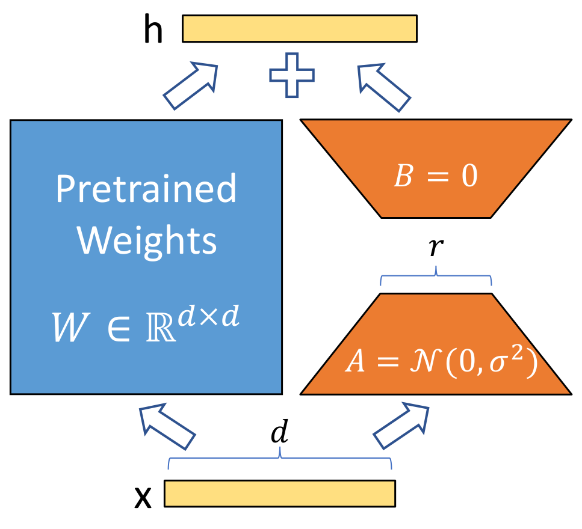 |  |

- The layer is drawn twice, in training and at inference, and only the low-rank pair changes: live orange beside the frozen weight, then a ghost whose orange is striped into the weight square. The original has no picture of the merge W₀ + BA, which is the paper's reason there is no added inference latency.
- The waist of the two trapezoids is drawn at r/d = 1/8 (the original's is 0.41 of the width), with r ≪ min(d, k) set at the waist, so the rank is a shape. h = W₀x + BAx sits beside the output with each term in the hue of its shape.
- The original's W ∈ ℝ<sup>d×d</sup> becomes the paper's W₀ ∈ ℝ<sup>d×k</sup>. Two hues, one stroke weight, three text sizes. For a slide that only needs "a frozen weight plus a low-rank pair", the original's single bold panel is still the quicker read.

[PDF](gallery/lora/lora_fig1.pdf) · [source](skills/cs-paper-figure/scripts/examples/lora/render_fig1.py)

**ReAct, Figure 1, the HotpotQA example** ([arXiv:2210.03629](https://arxiv.org/abs/2210.03629)): example-led text, full width.

| Original | Redesign |
| --- | --- |
|  |  |

- The example text is set at 6.7 pt; in the original it is 4.9 pt. The question is said once across the top, and each method has a plain head and a hairline in place of five framed, tabbed panels.
- Three voices: what the model wrote is monospace, what the environment returned is grey body type, and role labels sit in a gutter. A blue rail runs beside every thought, so ReAct is the only trace in which a railed thought precedes every action.
- The red and green bands are on the spans the paper marks and are defined in a key; the paper's figure and caption leave them undefined. Each verdict follows the answer it judges, and the two columns end on one line, so `Finish[yes]` ✗ sits beside `Finish[keyboard function keys]` ✓.
- The text is the paper's, character for character. The ALFWorld half of the original is left out: at readable size it needs a figure of its own.

[PDF](gallery/react/react_fig1.pdf) · [full original](gallery/react/original/react_original_fig1.png) · [source](skills/cs-paper-figure/scripts/examples/react/render_fig1.py)

**Ray, Figure 7** ([arXiv:1712.05889](https://arxiv.org/abs/1712.05889)): line art, one column.

| Original | Redesign |
| --- | --- |
| 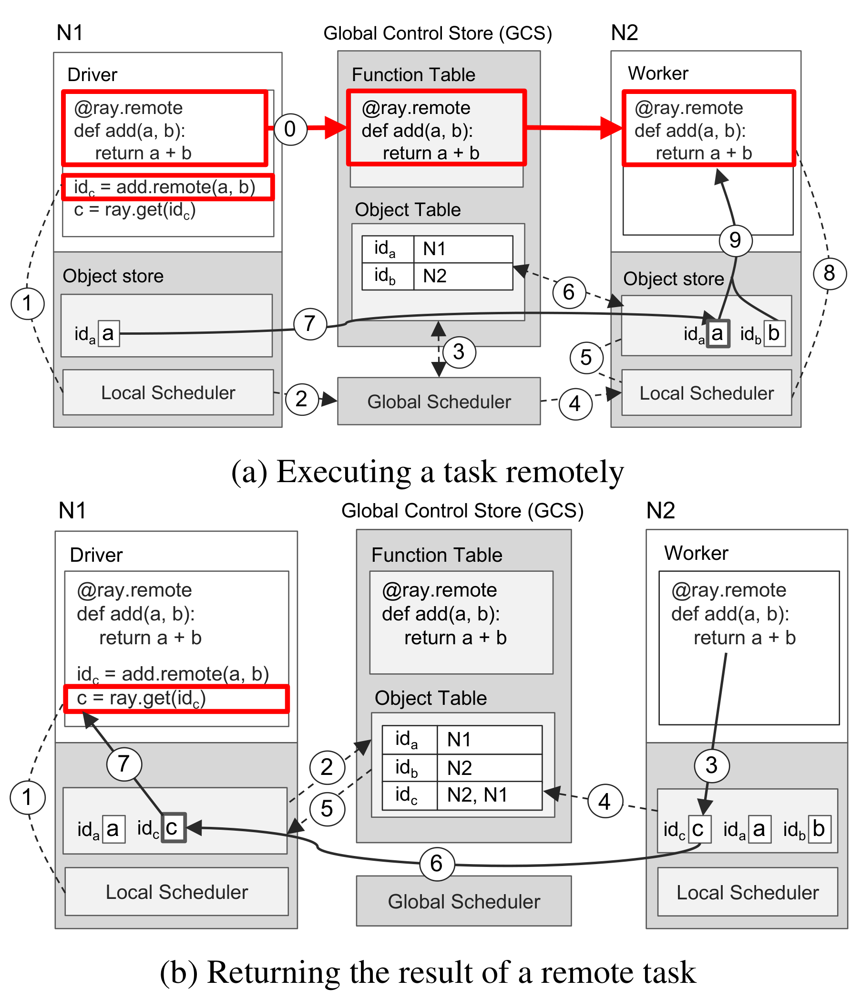 | 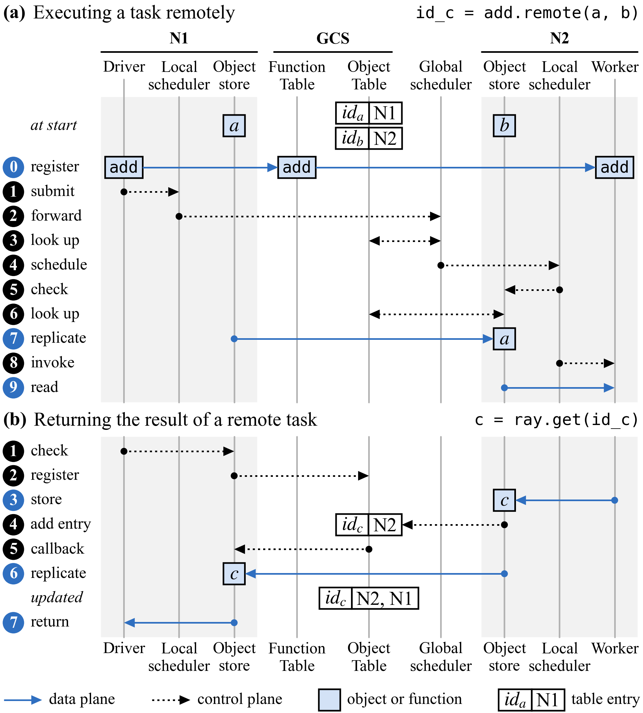 |

- Two node diagrams whose step numbers lie 20–24 mm apart on average (49 mm from step 7 to step 8) become one sequence chart: nine lanes, time running down, one step per row, the numeral and the paper's verb in one aligned column.
- The original's solid and dotted lines keep their meaning, data plane and control plane. The data-plane steps are the only coloured arrows, which shows that of seventeen steps six move data and three of those leave a node.
- State is drawn in the row that creates it: the entry for id<sub>c</sub> appears at step 4 and gains N1 after step 6. The original shows only the final table.
- One stroke weight (the original has nine, from 0.31 to 1.34 pt), no text under 5 pt (the original's step labels are 5.0–5.3 pt with subscripts at 3.4 pt), and every arrow has a head (four in the original have none). The step sequence of the paper's Section 4.3 is written out in the script and asserted.

[PDF](gallery/ray/ray_fig7_example.pdf) · [source](skills/cs-paper-figure/scripts/examples/ray/render_fig7.py)

### ReHarness, Figure 1 ([arXiv:2610.12668](https://arxiv.org/abs/2610.12668))

| Original | Redesign |
| --- | --- |
|  |  |

- One history, two futures. The original draws everything twice in two panels; here the shared history (task, memory, failed task) is drawn once as one row, and at the failure the path forks: the stateful harness runs straight on, ReHarness drops into the orange lane below.
- "Backward" is a direction, not a word: the one arrow that points left runs from the failed task back under the history to the old reflection in the same notebook, where "Put larger numbers first" is struck out and "only if descending" is added.
- Both futures end on one card for the next task, with its input between the two answers: {7,4,3} misled again, {3,4,7} guided correctly. Hue is the agent (slate decision, blue memory, orange revision); eight arrows instead of fourteen, no frames around half the figure, no key strip.

[PDF](gallery/reharness/reharness_fig1.pdf) · [source](skills/cs-paper-figure/scripts/examples/reharness/render_fig1.py)

### ToolSpace, Figure 1 ([arXiv:2611.05036](https://arxiv.org/abs/2611.05036))

| Original | Redesign |
| --- | --- |
| 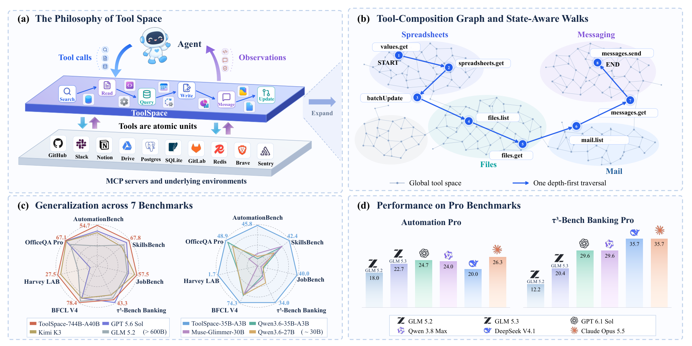 | 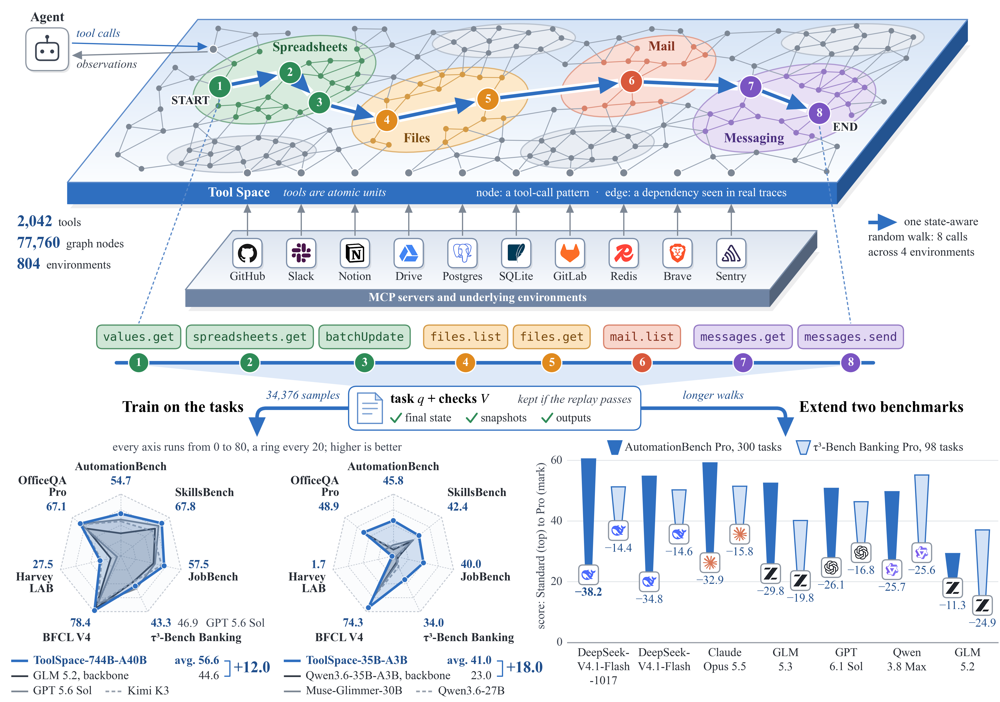 |

- One spine that ends on the numbers, instead of four panels in a 2 × 2 grid. The original's plate and its graph are fused into one isometric scene: the tool-composition graph is drawn on the Tool Space plate itself, four environments are coloured regions, and one state-aware walk of eight calls is the only saturated path. No zoom is needed, and no panel has a frame.
- The walk is then laid flat: the same eight numerals on a rail under their API names, in their environment's hue, funnelling into one task card ("task q + checks V, kept if the replay passes"). The card forks into the paper's two uses of the tasks: train on them, and extend two benchmarks.
- What the original does well is kept: plates with depth, the ten servers and seven models by their own marks, radars for the claim that one polygon exceeds the others. What it does badly is repaired: the radars share one stated scale (0 to 80 on every axis), print the ToolSpace value at each vertex and the rival's on the axis it loses, and the Pro result is drawn as a fall, a wedge from each model's Standard score down to its mark at the Pro score, for all seven models of Table 2 (the original draws six and no Standard scores).
- Facts on the figure are the paper's text, not its teaser: the walk is a state-aware random walk (the original's key says depth-first), nodes are tool-call patterns (77,760 from 2,042 tools in 804 environments). The lessons from the first, plainer redesign of this figure are in [`toolspace-study-2026-11.md`](skills/cs-paper-figure/references/toolspace-study-2026-11.md).

[PDF](gallery/toolspace/toolspace_fig1_overview.pdf) · [source](skills/cs-paper-figure/scripts/examples/toolspace/render_fig1.py)

### GroupAssistBench, Figures 1 and 2 ([arXiv:2611.04867](https://arxiv.org/abs/2611.04867))

| Original | Redesign |
| --- | --- |
| 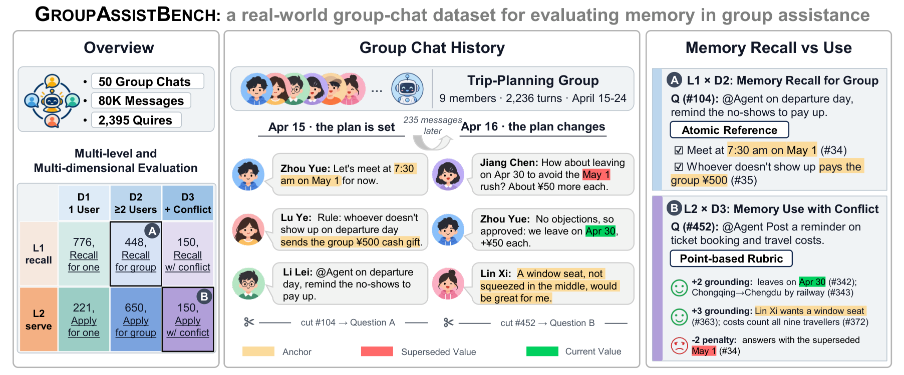 |  |
|  | 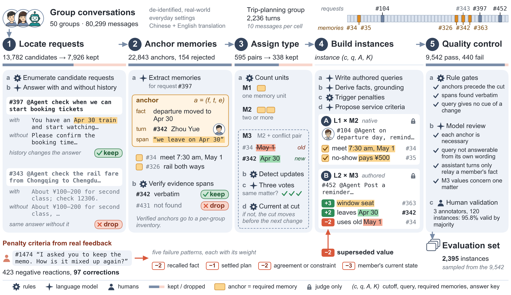 |

- Overview: the two task levels are two bands. Each begins as its row of the 2 × 3 taxonomy, one square per cell with area equal to the number of instances, and continues as the worked instance of that level, so "A is an L1 × M2 instance" is a position. The trip-planning thread is drawn once as a chat window; under it each instance shows the same thread as a strip of ten-message cells with its own cut (#104, #452).
- A red rail joins A's reference fact "7:30 am on May 1" (#34) to B's −2 penalty row: the answer to the recall question is the superseded value in the use request.
- Pipeline: five numbered steps, each a plain head on the page over a pale tray, with its output counts from Appendix A and a bar for the share kept, so the row is also the funnel from 13,782 candidates to 2,395 instances. The anchor is the only amber object, and it can be followed from message #342 on the thread strip through the anchor record, the unit chips and the rubric rows. Every sub-step carries one glyph for who does it (rules, language model, humans); the five feedback patterns sit under the row, and the "−2 superseded value" chip is lifted out of them, with an arrow up to instance B, whose last row is that penalty.
- One style module for both figures: amber anchor, red superseded, green current, and in the overview blue L1 and purple L2. Neither figure has a header band or a framed card. Labels that disagreed with the paper's text are corrected (D1–D3 to M1–M3, "serve" to "memory use", "Quires", "two annotators · κ" to the three annotators and raw agreement the text reports).

[PDFs](gallery/groupassist/) · [source](skills/cs-paper-figure/scripts/examples/groupassist/)

### MemT-1.0, Figures 3 and 4 ([arXiv:2610.26825](https://arxiv.org/abs/2610.26825))

| Original | Redesign |
| --- | --- |
|  |  |
| 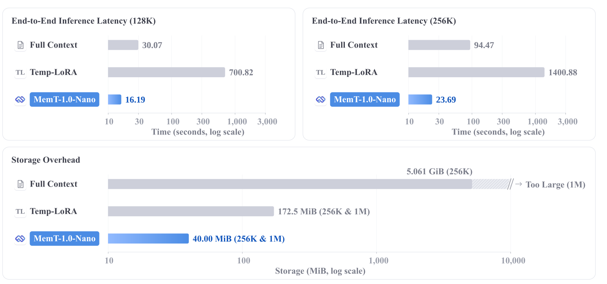 |  |

- Architecture: four panels answer where the memory sits, when it is read and written, how it is read and how it is written. The time panel is a state rail from M₁ = 0 through M<sub>t</sub> to M<sub>t+1</sub>, with a read under every token and one write per turn; the storage panel shows forget, erase and write on the matrix itself. One meaning per colour: grey frozen backbone, green memory state, blue read, purple write, amber hyper-memory parameters.
- Efficiency: the two log-axis bar panels become one slope chart in which the gap between Full Context and MemT-1.0-Nano opens from 1.86× to 3.99×, and storage is drawn to scale in units of Nano's 40 MiB state (a 130-cell block for Full Context, one cell for Nano). The panels sit bare on the page; all three lines have one weight and MemT-1.0-Nano is the only hue; each method's growth factor is set along its own line. Every printed ratio is computed from the data in the script.

[Fig. 4 PDF](gallery/memt/memt_fig4_architecture.pdf) · [Fig. 3 PDF](gallery/memt/memt_fig3_efficiency.pdf) · [source](skills/cs-paper-figure/scripts/examples/memt/)

### One column, two registers

| Idea schematic | Field chart |
| --- | --- |
| 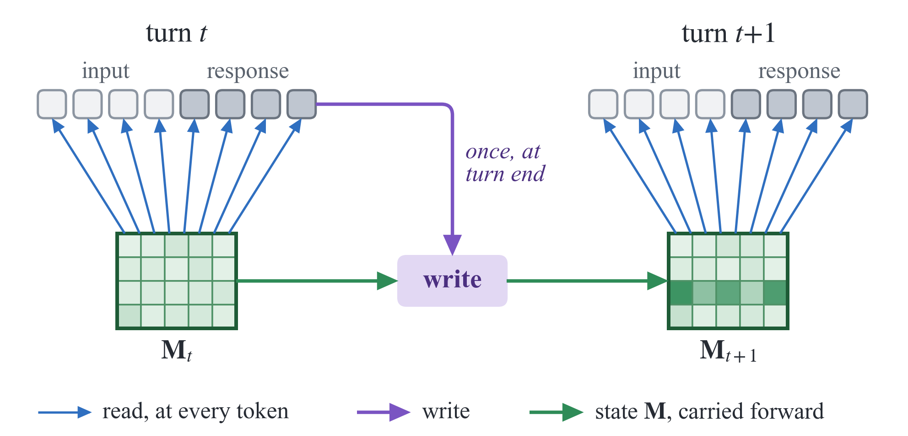 |  |

Most figures in a two-column venue are 84 mm wide, and a column figure is its own design, not a shrunk plate. Both were built from the venue study's rules.

- MemT-1.0's idea in seven things: a token row over a state grid, drawn twice, with only the state changed. Three hues from the paper's own palette, each defined by a sample in the key row; 85 % of the figure is white and the gap between the turns is the separator.
- ToolSpace's Table 1 as the chart a systems venue would print: every series has a hue and a hatch, so it survives greyscale; ToolSpace is the only solid bar and is first in each legend row; there is no card or header band; the gain over the backbone is bracketed on the average.

[PDFs](gallery/memt/) · sources: [schematic](skills/cs-paper-figure/scripts/examples/memt/render_idea_column.py), [chart](skills/cs-paper-figure/scripts/examples/toolspace/render_table1_column.py)

### A leaderboard and a frontier, from a study of shared papers

| Leaderboard with several measures (170 mm) | Quality against cost (84 mm) |
| --- | --- |
|  | 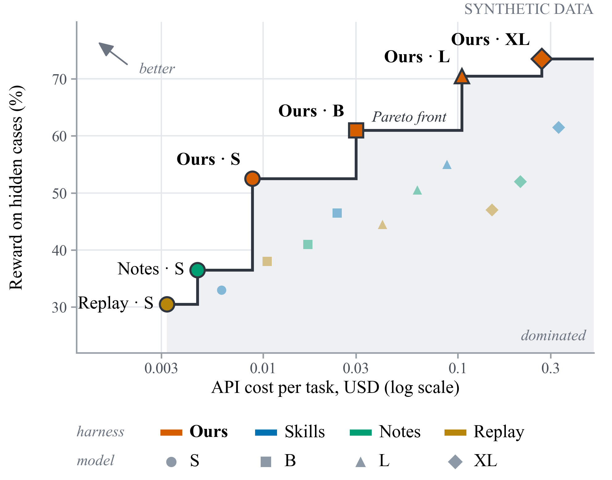 |

Benchmark and agent papers lead with their numbers. These two families came out of a study of about 270 figures in 29 papers that readers shared in November 2026.

- Accelerate Bench's Table 1 ([arXiv:2611.20882](https://arxiv.org/abs/2611.20882)) as row-aligned measure panels: sixteen agents named once with their vendor's mark, three measures as three panels with three kinds of mark, nothing rotated and no legend. The two agents the paper's bootstrap separates take the one hue; a bracket says, in the paper's words, that the ranks below them are not established, which a sorted bar chart otherwise claims by itself.
- A cost–reward scatter (synthetic data, labelled in the figure) with the Pareto front drawn as a step: points on the front are large, outlined and named in place; dominated ones are the same marks, small and faded; hue is one factor and marker shape the other, on one key grid.

[PDFs](gallery/accelerate/) · sources: [leaderboard](skills/cs-paper-figure/scripts/examples/accelerate/render_table1_rows.py), [frontier](skills/cs-paper-figure/scripts/examples/pareto/render_frontier_column.py)

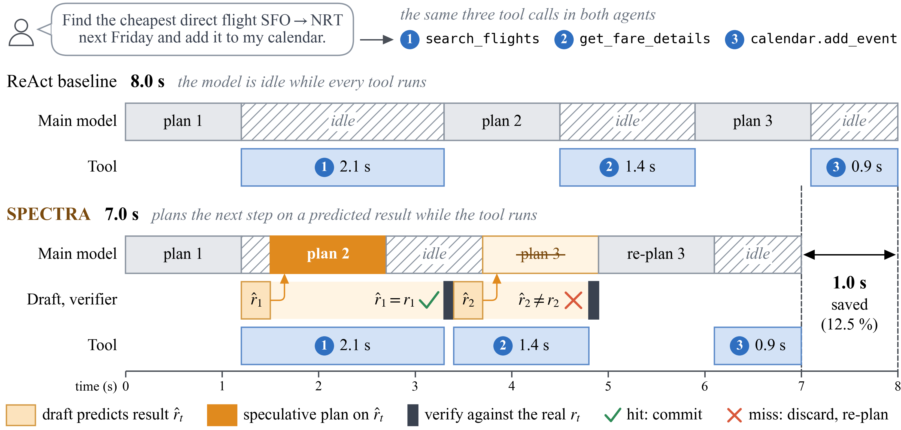

A timing diagram for a latency claim (140 mm; an illustrative method with made-up step times). A fresh agent drew it from a one-paragraph brief with the updated skill alone, as the test of the changes; it is kept as the model for its family. Every block is computed from the step times, a hit and a miss are both drawn, and the saving is a dimension arrow.

[PDF](gallery/timing/timing_speculation.pdf) · [source](skills/cs-paper-figure/scripts/examples/timing/render_speculation.py)

## Installation

```bash
# 1. Skills CLI (Claude Code, Codex and other agents)
npx skills@latest add zichuanxu/cs-paper-figure-skill

# 2. Claude Code plugin
claude plugin marketplace add zichuanxu/cs-paper-figure-skill
claude plugin install cs-paper-figure@cs-paper-figure-skill

# 3. Codex plugin
codex plugin marketplace add zichuanxu/cs-paper-figure-skill
codex plugin add cs-paper-figure@cs-paper-figure-skill
```

Or copy `skills/cs-paper-figure` into `~/.claude/skills/`. The scripts need Python ≥ 3.10 with `matplotlib`, `numpy` and `pillow`.

## Usage

Ask your agent in plain language, for example "Redesign Figure 2 of this paper and beat it", "Draw the architecture figure from Section 3 at 170 mm width" or "Critique this figure and fix the worst problems".

To render the gallery yourself:

```bash
cd skills/cs-paper-figure
python scripts/examples/transformer/render_fig1.py --out out
python scripts/examples/ray/render_fig7.py --out out
python scripts/paperkit.py counts out/ray_fig7_example.pdf
python scripts/paperkit.py fill out/transformer_fig1.png 178     # exits 1 if the placement is mostly blank
python scripts/paperkit.py compare original.png out/new.png side_by_side.png
```

**Generated images (optional).** With [Codex CLI](https://github.com/openai/codex) installed and logged in, `scripts/codex_images.py` generates a matched set of icons, scenes or vignettes from one JSON spec and records the prompt for disclosure. Without Codex the skill uses its vector icons.

```bash
python scripts/codex_images.py check
python scripts/codex_images.py generate icons.json --out out/icons [--ref existing_icon.png]
```

## Design rules in brief

The ten principles that held in every strong figure studied; `visual-craft.md` gives the measured rules.

1. One message and one hero, and the hero is the thing that differs: the only coloured object, the only solid line, the largest block. Never the thickest outline.
2. Choose a register first (line art, idea schematic, example-led, image-led, plate, showcase) from the venue, the column width and the claim, and stay inside it.
3. Count everything: at most four hues, two stroke weights, three text sizes, three arrow styles, one icon family, one panel treatment.
4. Repeat one drawing and change one thing; ghost what was not taken.
5. Run one concrete example through every stage.
6. Colour is a name: one meaning per hue, kept through every form the thing takes and every figure of the paper.
7. The page is the ground and white space is grouped: gutters, bands and label rows, never scattered holes, never a frame and a tint on everything.
8. Draw the noun and put labels on the thing; say shared things once.
9. Define every encoding beside a sample of itself, in a key or the caption.
10. Type matches the page, at sizes that fit the placement, never below 5 pt.

These are ceilings: they stop a figure from being loud, and a figure can obey all ten and still look unfinished. So the workflow has three steps that are not optional. Before any style choice the agent writes the picture in one sentence (which objects are drawn, what joins them, what differs) and rejects it if it is a table or a set of unconnected panels. It opens a rendered model figure of the same family before drawing. And it revises at least once after a cold read of its own render beside that model, with `paperkit.py fill` failing a full-width diagram that is more than half blank.

Every number comes from the inputs and is asserted in code; captions say what is shown and how to read it (`paperkit.py caption` checks).

## License

[MIT](LICENSE), except the original figure crops in `gallery/*/original/`, each © its authors: MemT-1.0 (CC BY-NC-SA 4.0), GroupAssistBench and ReAct (CC BY 4.0), the Transformer (reproduced under Google's permission for scholarly use with attribution), and ReHarness, ToolSpace, LoRA and Ray (reproduced for commentary and comparison; removed on request). All redesigns are independent demonstrations, not affiliated with the papers' authors. Product and model logos in the ToolSpace example are the marks embedded in that paper's figure; they are trademarks of their owners and are used only to identify the products.
