# cs-paper-figure

An agent skill for designing, drawing and critiquing figures for computer-science papers: method and architecture diagrams, idea schematics, system and protocol figures, annotated examples, teasers and comparison grids, and evaluation charts, at single-column or full width. Its rules are measured from award papers at NeurIPS, ICLR, ICML, CVPR, ICCV, SIGGRAPH, ACL, EMNLP, NAACL, CHI, UIST, SOSP, OSDI, NSDI, PLDI and VLDB and from recent AI-lab reports, and it ships a small drawing library so the agent produces editable, reproducible vector figures instead of generic flowcharts.


<sub>The Transformer (*Attention Is All You Need*, Figure 1), redesigned with this skill.</sub>

## What is inside

| Part | Purpose |
| --- | --- |
| [`SKILL.md`](skills/cs-paper-figure/SKILL.md) | Ten design principles and the workflow: brief → message, hero and register → structure → visual system → reproducible source → review |
| [`model-figures.md`](skills/cs-paper-figure/references/model-figures.md) + [`assets/models/`](skills/cs-paper-figure/assets/models/) | What to look at before drawing: the seven things every strong figure has that a rule-abiding plain one lacks, the two ways a figure passes every check and still fails (the typeset table, the islands), and a rendered model figure for each of 16 families |
| [`visual-craft.md`](skills/cs-paper-figure/references/visual-craft.md) | The rulebook by design dimension, with measured values: message and hero, register, colour, typography, layout, white space, shapes, icons, arrows, text, charts, captions, redesign protocol, checklist |
| [`registers.md`](skills/cs-paper-figure/references/registers.md) | Rules for one kind of figure at a time: line art (systems, PL, theory), idea schematics, example-led text and interface figures, image-led teasers and grids, plates, benchmark contrast figures, showcase teasers |
| [`venue-study-2026-11.md`](skills/cs-paper-figure/references/venue-study-2026-11.md) | The evidence: about 90 figures from 29 award papers at 17 venues, measured; what held in every venue family, which earlier rules of this skill it overturned, and model figures per family |
| [`architecture-study-2026-11.md`](skills/cs-paper-figure/references/architecture-study-2026-11.md) | What 23 vision/multimodal method figures (Holmes, ReSet, CoPS, SemDiff, LFBNet, HFF-Net, VideoFusion, …) do well and badly, and the rules taken from them |
| [`arebench-study-2026-11.md`](skills/cs-paper-figure/references/arebench-study-2026-11.md) | What ARE-bench Figs. 1–3 do well and badly: contrast figures, task cut strips, workspace file trees, construction pipelines, results-chart colour identity |
| [`toolspace-study-2026-11.md`](skills/cs-paper-figure/references/toolspace-study-2026-11.md) | What ToolSpace Fig. 1 does well (isometric plates, logos as identity marks, radar envelopes) and how a tidier redesign lost it: the "strengths first" rule for redesigns |
| [`paperkit.py`](skills/cs-paper-figure/scripts/paperkit.py) | Drawing primitives in millimetres at print size (cards, section frames, cuboids and layer slabs, feature maps, numeric matrices, mini plots, graphs, key strips, matrices, trapezoids, ⊕/⊙, tokens, documents, icons, routed arrows, typeset math) column-width charts (`axes_grid`, `chart_legend`, greyscale-safe `SERIES_STYLE`, `curve_label`), marked spans and wrapped example text (`rich`, `para`), code listings and callouts, plain panel heads, relation threads between marked spans (`thread`, `spans`), user and agent glyphs, plus layout audits and `fill`, `counts`, `density`, `grey`, `compare`, `parity` and `caption` checks |
| [`figure-series.md`](skills/cs-paper-figure/references/figure-series.md) | Figure series for surveys and frameworks: one taxonomy palette, chapter frames, running examples, gate stacks, spectra, illustrated scenes with vector dialogue |
| [`codex_images.py`](skills/cs-paper-figure/scripts/codex_images.py) + [`image-generation.md`](skills/cs-paper-figure/references/image-generation.md) | Optional matched icons, scenes and vignettes generated with Codex CLI, embedded at full resolution |
| `scripts/examples/`, `references/` | The gallery's render scripts; a 120-paper figure corpus, per-lab studies and review checklists |

## Gallery

Each redesign keeps the paper's components, values and notation; only the drawing changes.

### The Transformer, Figure 1 ([arXiv:1706.03762](https://arxiv.org/abs/1706.03762))

| Original | Redesign |
| --- | --- |
|  |  |

- The three multi-head attention blocks are the only saturated blocks and carry numbers 1–3. Each has the same K, V, Q ports; only the colour of what enters changes: all blue for encoder self-attention, all coral for masked decoder self-attention, and a blue-to-coral blend fed by the encoder output **z**, "to every decoder layer".
- "Add & Norm" is opened into a residual wire, ⊕ and a LayerNorm bar. The two embeddings and the pre-softmax linear layer are three amber trapezoids (one shared weight matrix). "Shifted right" is the one-column offset between the decoder input row and the predicted row of an English→German example.
- Panel (b) zooms from the stack of h = 8 heads into one head with numbers (scores → mask → softmax → weights whose rows sum to 1). Panel (c) shows the three uses as query-by-key matrices over the example tokens, with hatched −∞ cells for the causal mask.
- The whole figure uses three text sizes and two stroke weights (the heavier one is the token stream), counted from the PDF. The panels sit bare under plain heads with white gutters between them, the encoder output **z** is drawn as a matrix with one row per input token, and one key strip runs along the bottom.

[PDF](gallery/transformer/transformer_fig1.pdf) · [source](skills/cs-paper-figure/scripts/examples/transformer/render_fig1.py)

### Three well-known figures, three registers

A register is a coherent set of choices for ground, fills, strokes and type; the skill picks one before any style value. These three redesigns are each in a different one.

**LoRA, Figure 1** ([arXiv:2106.09685](https://arxiv.org/abs/2106.09685)): idea schematic, one column.

| Original | Redesign |
| --- | --- |
| 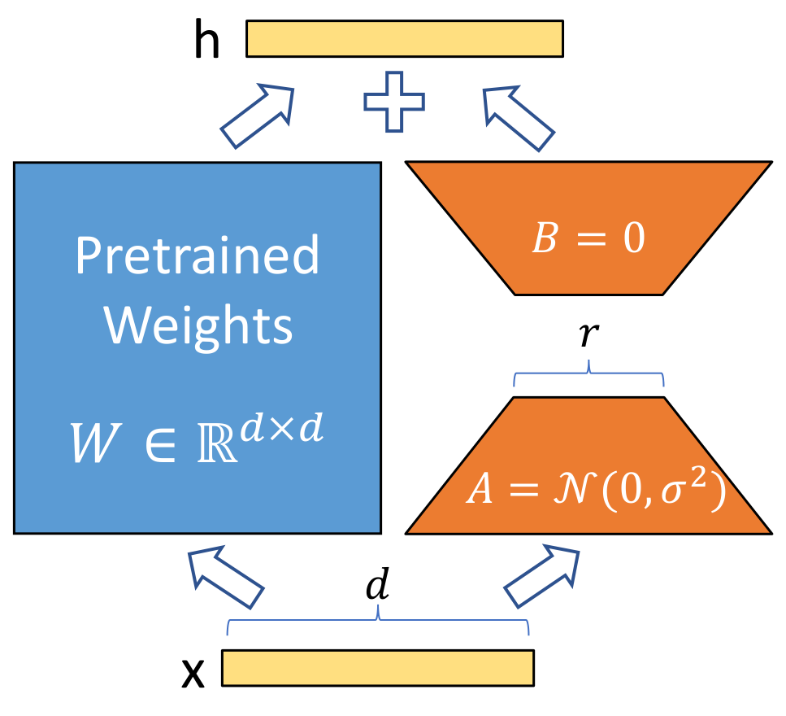 | 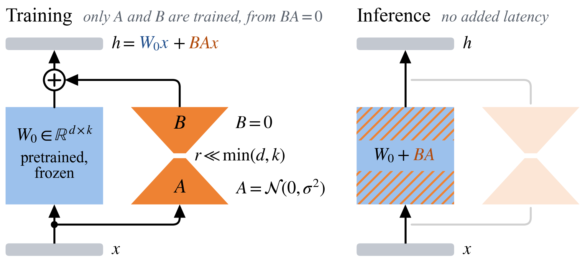 |

- The layer is drawn twice, in training and at inference, and only the low-rank pair changes: live orange beside the frozen weight, then a ghost whose orange is striped into the weight square. The original has no picture of the merge W₀ + BA, which is the paper's reason there is no added inference latency.
- The waist of the two trapezoids is drawn at r/d = 1/8 (the original's is 0.41 of the width), with r ≪ min(d, k) set at the waist, so the rank is a shape. h = W₀x + BAx sits beside the output with each term in the hue of its shape.
- The original's W ∈ ℝ<sup>d×d</sup> becomes the paper's W₀ ∈ ℝ<sup>d×k</sup>. Two hues, one stroke weight, three text sizes. For a slide that only needs "a frozen weight plus a low-rank pair", the original's single bold panel is still the quicker read.

[PDF](gallery/lora/lora_fig1.pdf) · [source](skills/cs-paper-figure/scripts/examples/lora/render_fig1.py)

**ReAct, Figure 1, the HotpotQA example** ([arXiv:2210.03629](https://arxiv.org/abs/2210.03629)): example-led text, full width.

| Original | Redesign |
| --- | --- |
| 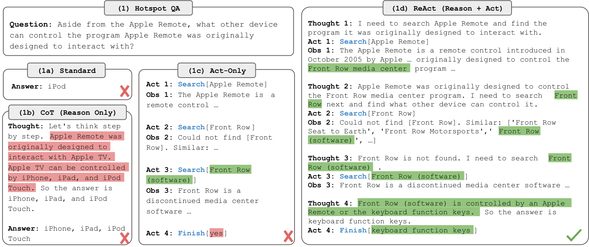 | 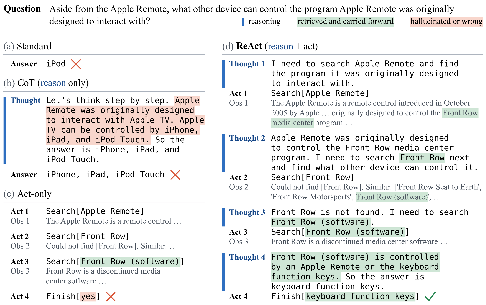 |

- The example text is set at 6.7 pt; in the original it is 4.9 pt. The question is said once across the top, and each method has a plain head and a hairline in place of five framed, tabbed panels.
- Three voices: what the model wrote is monospace, what the environment returned is grey body type, and role labels sit in a gutter. A blue rail runs beside every thought, so ReAct is the only trace in which a railed thought precedes every action.
- The red and green bands are on the spans the paper marks and are defined in a key; the paper's figure and caption leave them undefined. Each verdict follows the answer it judges, and the two columns end on one line, so `Finish[yes]` ✗ sits beside `Finish[keyboard function keys]` ✓.
- The text is the paper's, character for character. The ALFWorld half of the original is left out: at readable size it needs a figure of its own.

[PDF](gallery/react/react_fig1.pdf) · [full original](gallery/react/original/react_original_fig1.png) · [source](skills/cs-paper-figure/scripts/examples/react/render_fig1.py)

**Ray, Figure 7** ([arXiv:1712.05889](https://arxiv.org/abs/1712.05889)): line art, one column.

| Original | Redesign |
| --- | --- |
| 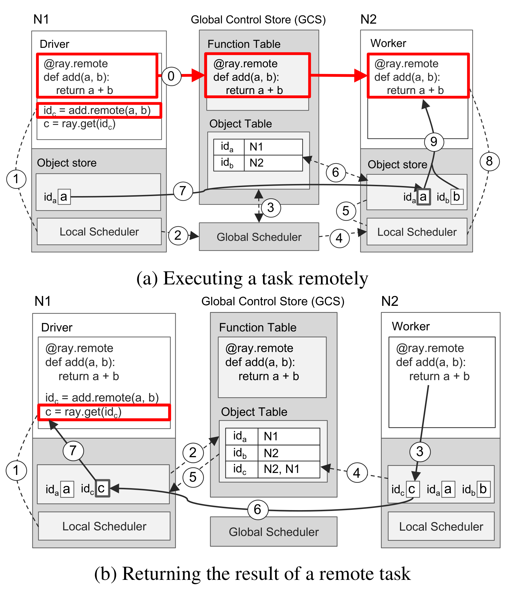 | 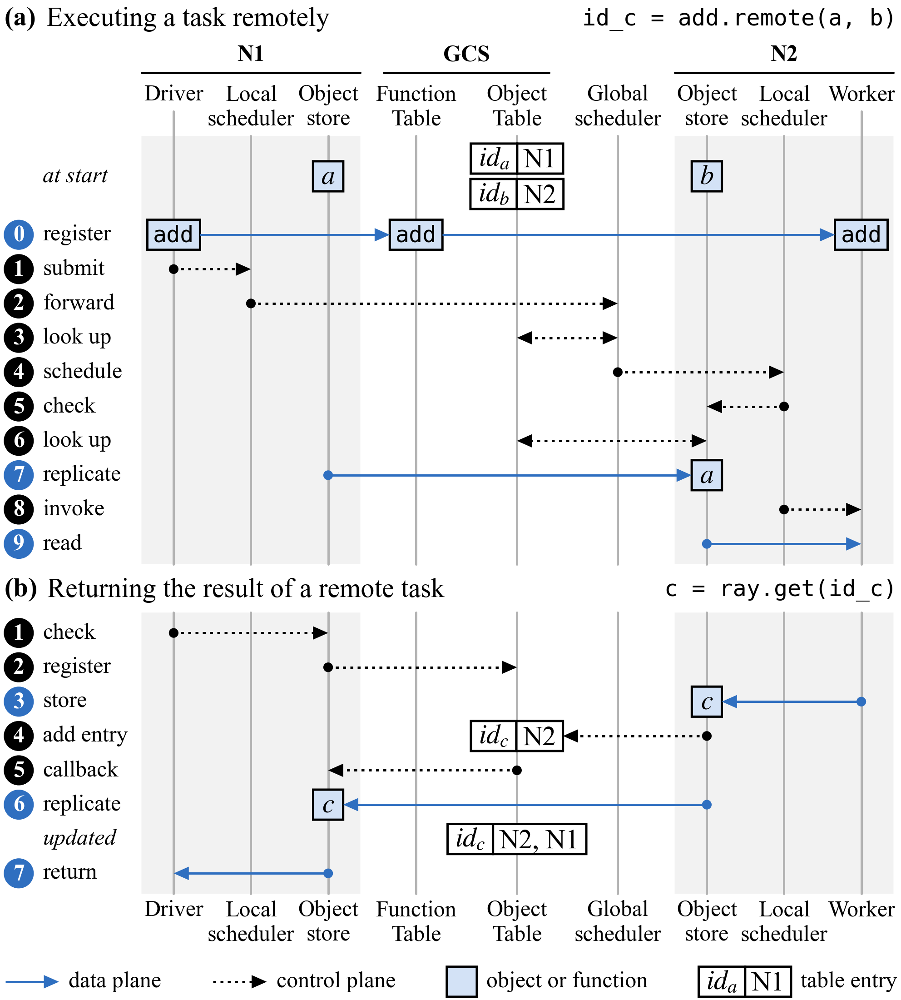 |

- Two node diagrams whose step numbers lie 20–24 mm apart on average (49 mm from step 7 to step 8) become one sequence chart: nine lanes, time running down, one step per row, the numeral and the paper's verb in one aligned column.
- The original's solid and dotted lines keep their meaning, data plane and control plane. The data-plane steps are the only coloured arrows, which shows that of seventeen steps six move data and three of those leave a node.
- State is drawn in the row that creates it: the entry for id<sub>c</sub> appears at step 4 and gains N1 after step 6. The original shows only the final table.
- One stroke weight (the original has nine, from 0.31 to 1.34 pt), no text under 5 pt (the original's step labels are 5.0–5.3 pt with subscripts at 3.4 pt), and every arrow has a head (four in the original have none). The step sequence of the paper's Section 4.3 is written out in the script and asserted.

[PDF](gallery/ray/ray_fig7_example.pdf) · [source](skills/cs-paper-figure/scripts/examples/ray/render_fig7.py)

### Harness², Figures 2 and 3 ([arXiv:2610.14224](https://arxiv.org/abs/2610.14224))

| Original | Redesign |
| --- | --- |
|  |  |
|  |  |

- Fig. 2 follows one model call from left to right: files, context, frozen model, plugin hook, tools. Each of the eight components is a file card with its activation as a tag on the border (solid = every call, dashed = on demand), and the context is a stack whose bands take the colour of the group that owns them.
- Fig. 3 nests the task-level frame inside the harnessing-level frame. Every harness is a rack of C1–C8 in which grey cells are inherited, teal cells were edited by the invariant candidate and coral cells by the domain candidate, so the composed successor shows the merge on the object. Both probes are contrasted with the same reference record e₀.
- The two figures share one visual system (the rack, the execution-record page, one robot and file-icon family, no hue with two meanings). The icons come from the skill's Codex helper; `--vector-icons` renders without them.

[Fig. 2 PDF](gallery/harness2/harness2_fig2_components.pdf) · [Fig. 3 PDF](gallery/harness2/harness2_fig3_pipeline.pdf) · [source](skills/cs-paper-figure/scripts/examples/harness2/)

### A figure series: *Proactive AI for Superintelligent Agents*

Six figures of a 15-figure survey ([PDF](https://storage.googleapis.com/gweb-research2023-media/pubtools/1048480.pdf)) rebuilt as one series; Fig. 1 is shown here, the other five are in the PDFs and source linked below. The originals are illustrated figures, and their pictures, solid headers and large type are what make them work, so the redesigns keep all of that and fix the faults: each capacity's colour now stays the same in every figure (the paper paints Agenda pink, purple and blue), text baked into the illustrations becomes editable vector text, and overlapping eras, crossings and uneven type are cleaned up. The 41 illustrations come from the skill's Codex helper as one cast; every redesign passes `paperkit.py parity` (not emptier, greyer or less illustrated than its original).

| | Original | Redesign |
| --- | --- | --- |
| **Fig. 1**, proactive vs. reactive |  |  |

- Two rows over three shared columns (identify the work and initiate action, act, outcome). In the reactive row the first columns are the user's turn; in the proactive row the same columns hold Awareness, Anticipation, Agenda and Arbitration, and "Act when asked" sits directly above "Action: before being asked".
- Each stage card ends in an object made from its own definition: a progress bar with the gap left open, the candidate goals as a checklist, three ticked tests (worthwhile, timely, safe), and suggest / assist / execute on a lightness ramp.
- Adaptation is a rail under the stages: outcomes and feedback enter it, dashed arrows return to every capacity, and no feedback line crosses a card.

[PDFs](gallery/proactive/) · [source](skills/cs-paper-figure/scripts/examples/proactive/) · [what the studies found](skills/cs-paper-figure/references/figure-series.md)

### ReHarness, Figure 1 ([arXiv:2610.12668](https://arxiv.org/abs/2610.12668))

| Original | Redesign |
| --- | --- |
|  |  |

- One instance stream, two harnesses: the three trajectories are drawn once in the middle, with the stateful harness above and ReHarness below on the same column grid. The τ<sub>t+1</sub> card carries both answers, {7,4,3} wrong for (a) and {3,4,7} correct for (b).
- Backward revision is its own orange row under the unchanged blue forward row. The h′<sub>t</sub> card shows the edit itself: "Put larger numbers first" struck out, "Larger first only if descending" with the new condition highlighted.
- Every numbered edge carries its label on the wire ("write R<sub>t</sub>", "read R′<sub>t−1</sub>", "revise R<sub>t−1</sub>"), coloured by type; numbers are tokens shaded by magnitude, and each panel ends on a verdict pill.

[PDF](gallery/reharness/reharness_fig1.pdf) · [source](skills/cs-paper-figure/scripts/examples/reharness/render_fig1.py)

### ToolSpace, Figure 1 ([arXiv:2611.05036](https://arxiv.org/abs/2611.05036))

| Original | Redesign |
| --- | --- |
| 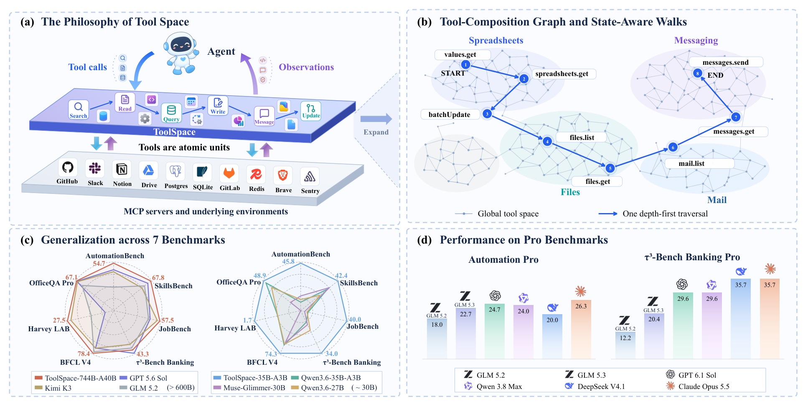 | 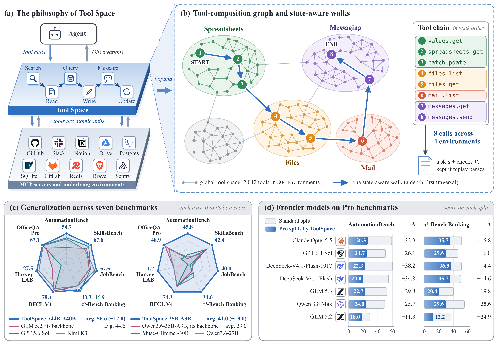 |

- What the original does well is kept: the tool space is a plate floating between the agent and a plate of MCP servers, with tools standing on it as tiles and the ten servers shown by their own logos; the two radar charts stay radars, because the claim is that one polygon encloses the others.
- What it does badly is repaired. ToolSpace is blue in every panel. Each radar prints the ToolSpace value at every vertex and, on the one axis it loses (τ³-Bench Banking, 43.3 against 46.9), the winner's value beside it; the card states that each axis runs from 0 to its best score. All baseline values are from the paper's Table 1.
- The upper plate opens by zoom rays into the largest panel, where one hue per environment is shared by a walk node, its cluster and its row in the tool chain: "8 calls across 4 environments". Panel (d) shows the drop the text claims, a pale bar to the Standard score and a blue bar to the Pro score for all seven models of Table 2, each row led by the model's mark; the original draws six models and no Standard scores.
- A first redesign of this figure replaced the plates, logos and radars with a flat box, text labels and dot rows, and came out tidier and plainer. The lessons are in [`toolspace-study-2026-11.md`](skills/cs-paper-figure/references/toolspace-study-2026-11.md), and `paperkit` gained `plate`, `tile` and `radar`.

[PDF](gallery/toolspace/toolspace_fig1_overview.pdf) · [source](skills/cs-paper-figure/scripts/examples/toolspace/render_fig1.py)

### GroupAssistBench, Figures 1 and 2 ([arXiv:2611.04867](https://arxiv.org/abs/2611.04867))

| Original | Redesign |
| --- | --- |
| 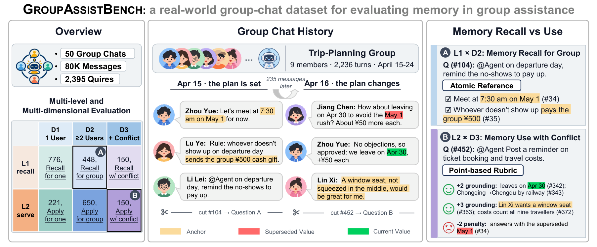 | 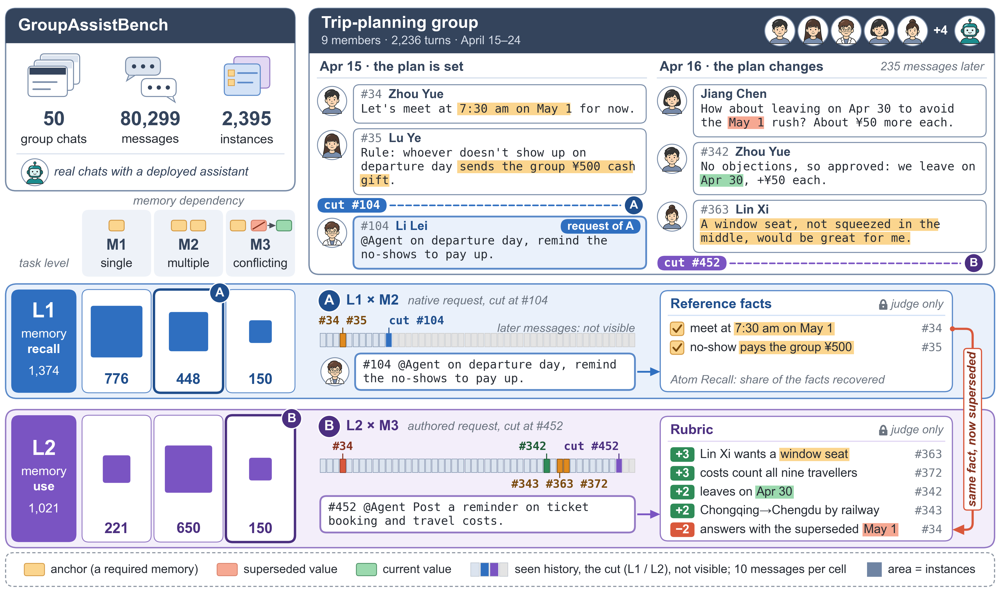 |
| 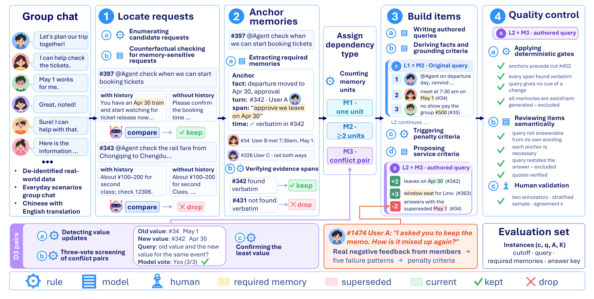 | 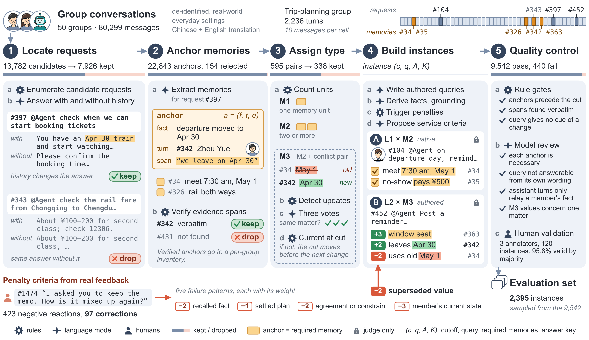 |

- Overview: the two task levels are two bands. Each begins as its row of the 2 × 3 taxonomy, one square per cell with area equal to the number of instances, and continues as the worked instance of that level, so "A is an L1 × M2 instance" is a position. The trip-planning thread is drawn once as a chat window; under it each instance shows the same thread as a strip of ten-message cells with its own cut (#104, #452).
- A red rail joins A's reference fact "7:30 am on May 1" (#34) to B's −2 penalty row: the answer to the recall question is the superseded value in the use request.
- Pipeline: five numbered steps, each a plain head on the page over a pale tray, with its output counts from Appendix A and a bar for the share kept, so the row is also the funnel from 13,782 candidates to 2,395 instances. The anchor is the only amber object, and it can be followed from message #342 on the thread strip through the anchor record, the unit chips and the rubric rows. Every sub-step carries one glyph for who does it (rules, language model, humans); the five feedback patterns sit under the row, and the "−2 superseded value" chip is lifted out of them, with an arrow up to instance B, whose last row is that penalty.
- One style module for both figures: amber anchor, red superseded, green current, and in the overview blue L1 and purple L2. Neither figure has a header band or a framed card. Labels that disagreed with the paper's text are corrected (D1–D3 to M1–M3, "serve" to "memory use", "Quires", "two annotators · κ" to the three annotators and raw agreement the text reports).

[PDFs](gallery/groupassist/) · [source](skills/cs-paper-figure/scripts/examples/groupassist/)

### MemT-1.0, Figures 3 and 4 ([arXiv:2610.26825](https://arxiv.org/abs/2610.26825))

| Original | Redesign |
| --- | --- |
|  |  |
|  |  |

- Architecture: four panels answer where the memory sits, when it is read and written, how it is read and how it is written. The time panel is a state rail from M₁ = 0 through M<sub>t</sub> to M<sub>t+1</sub>, with a read under every token and one write per turn; the storage panel shows forget, erase and write on the matrix itself. One meaning per colour: grey frozen backbone, green memory state, blue read, purple write, amber hyper-memory parameters.
- Efficiency: the two log-axis bar panels become one slope chart in which the gap between Full Context and MemT-1.0-Nano opens from 1.86× to 3.99×, and storage is drawn to scale in units of Nano's 40 MiB state (a 130-cell block for Full Context, one cell for Nano). The panels sit bare on the page; all three lines have one weight and MemT-1.0-Nano is the only hue; each method's growth factor is set along its own line. Every printed ratio is computed from the data in the script.

[Fig. 4 PDF](gallery/memt/memt_fig4_architecture.pdf) · [Fig. 3 PDF](gallery/memt/memt_fig3_efficiency.pdf) · [source](skills/cs-paper-figure/scripts/examples/memt/)

### One column, two registers

| Idea schematic | Field chart |
| --- | --- |
| 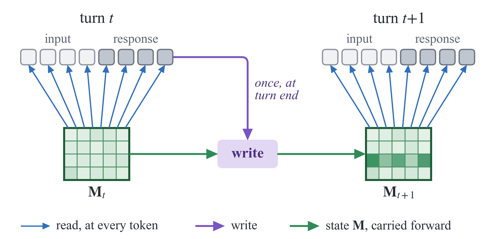 | 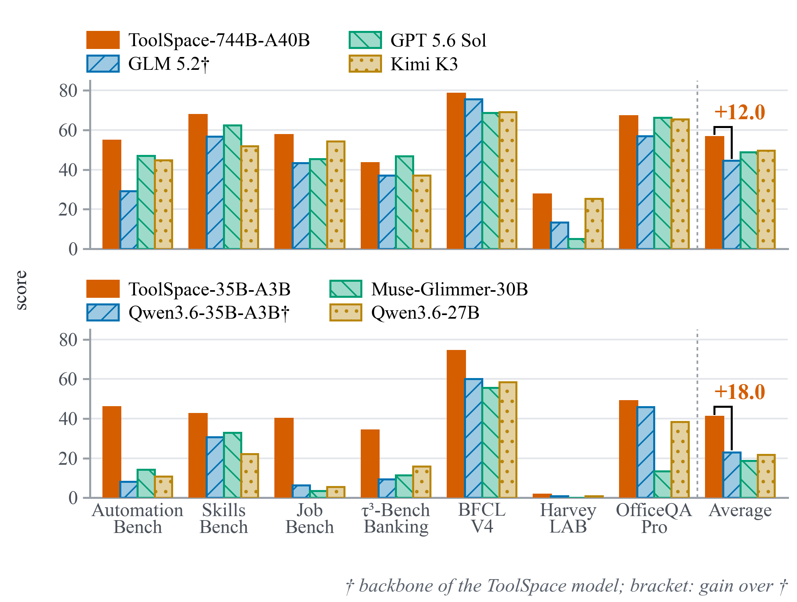 |

Most figures in a two-column venue are 84 mm wide, and a column figure is its own design, not a shrunk plate. Both were built from the venue study's rules.

- MemT-1.0's idea in seven things: a token row over a state grid, drawn twice, with only the state changed. Three hues from the paper's own palette, each defined by a sample in the key row; 85 % of the figure is white and the gap between the turns is the separator.
- ToolSpace's Table 1 as the chart a systems venue would print: every series has a hue and a hatch, so it survives greyscale; ToolSpace is the only solid bar and is first in each legend row; there is no card or header band; the gain over the backbone is bracketed on the average.

[PDFs](gallery/memt/) · sources: [schematic](skills/cs-paper-figure/scripts/examples/memt/render_idea_column.py), [chart](skills/cs-paper-figure/scripts/examples/toolspace/render_table1_column.py)

### A motivating example as a scene, not a table

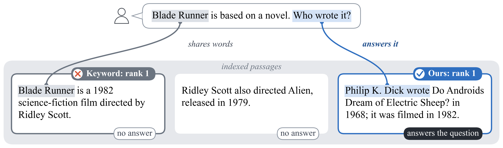

A motivating example is the figure most often drawn as a table: sentences in rows, a status column, score bars. This one (illustrative, written for the skill) draws what a table cannot. The user asks the question in a bubble, the passages are cards on one tray, and a thread runs from the marked words in the question to the card each retriever ranks first, grey for the keyword baseline and blue for ours, with the relation named on the thread. The threads start from span positions the kit records, so they sit on the words in the PNG, PDF and SVG alike.

[PDF](gallery/scene/retrieval_scene.pdf) · [source](skills/cs-paper-figure/scripts/examples/scene/render_retrieval_scene.py)

### Five more examples

Illustrative fixtures or synthetic data, not real benchmark results.

**Method.** A memory-update loop drawn as one clockwise cycle of real artifacts: ledger rows, three edit cards, a conflict matrix, the candidate record, and a paired-replay gate whose "3 > 1" drives the only arrow into memory v13.


**Attention.** One eight-column grid runs through the cache slots, the 4 × 8 causal mask and the worked read for q10, so a key keeps its position from the slot that stores it to the weight it receives.


**Experiment.** Four bare panels and one key row, with no cards. One policy keeps one colour and marker in all four panels; the primary contrast (+6.6 pp) is the only filled cloud of 24 seed-block dots, and the grand mean of the heat table is asserted equal to it.


**Scene planning.** Three candidate rollouts share one scene; the stretch of the direct path inside the barrier is the thick stroke with a cross, and the only solid arrow is the first step that is executed.


**Epoch context.** One lane per replayed case crosses the three stages on one line grid, with no panel frames and no wires. The regressed case is the only tinted lane, so it can be followed from the two checks that flipped to the context edit they caused and the clause that cites it.


[PDFs](gallery/after/) · [source](skills/cs-paper-figure/scripts/examples/restyled/)

## Installation

```bash
# 1. Skills CLI (Claude Code, Codex and other agents)
npx skills@latest add zichuanxu/cs-paper-figure-skill

# 2. Claude Code plugin
claude plugin marketplace add zichuanxu/cs-paper-figure-skill
claude plugin install cs-paper-figure@cs-paper-figure-skill

# 3. Codex plugin
codex plugin marketplace add zichuanxu/cs-paper-figure-skill
codex plugin add cs-paper-figure@cs-paper-figure-skill
```

Or copy `skills/cs-paper-figure` into `~/.claude/skills/`. The scripts need Python ≥ 3.10 with `matplotlib`, `numpy` and `pillow`.

## Usage

Ask your agent in plain language, for example "Redesign Figure 2 of this paper and beat it", "Draw the architecture figure from Section 3 at 170 mm width" or "Critique this figure and fix the worst problems".

To render the gallery yourself:

```bash
cd skills/cs-paper-figure
python scripts/examples/transformer/render_fig1.py --out out
python scripts/examples/ray/render_fig7.py --out out
python scripts/paperkit.py counts out/ray_fig7_example.pdf
python scripts/paperkit.py fill out/transformer_fig1.png 178     # exits 1 if the placement is mostly blank
python scripts/paperkit.py compare original.png out/new.png side_by_side.png
```

**Generated images (optional).** With [Codex CLI](https://github.com/openai/codex) installed and logged in, `scripts/codex_images.py` generates a matched set of icons, scenes or vignettes from one JSON spec and records the prompt for disclosure. Without Codex the skill uses its vector icons.

```bash
python scripts/codex_images.py check
python scripts/codex_images.py generate icons.json --out out/icons [--ref existing_icon.png]
```

## Design rules in brief

The ten principles that held in every strong figure studied; `visual-craft.md` gives the measured rules.

1. One message and one hero, and the hero is the thing that differs: the only coloured object, the only solid line, the largest block. Never the thickest outline.
2. Choose a register first (line art, idea schematic, example-led, image-led, plate, showcase) from the venue, the column width and the claim, and stay inside it.
3. Count everything: at most four hues, two stroke weights, three text sizes, three arrow styles, one icon family, one panel treatment.
4. Repeat one drawing and change one thing; ghost what was not taken.
5. Run one concrete example through every stage.
6. Colour is a name: one meaning per hue, kept through every form the thing takes and every figure of the paper.
7. The page is the ground and white space is grouped: gutters, bands and label rows, never scattered holes, never a frame and a tint on everything.
8. Draw the noun and put labels on the thing; say shared things once.
9. Define every encoding beside a sample of itself, in a key or the caption.
10. Type matches the page, at sizes that fit the placement, never below 5 pt.

These are ceilings: they stop a figure from being loud, and a figure can obey all ten and still look unfinished. So the workflow has three steps that are not optional. Before any style choice the agent writes the picture in one sentence (which objects are drawn, what joins them, what differs) and rejects it if it is a table or a set of unconnected panels. It opens a rendered model figure of the same family before drawing. And it revises at least once after a cold read of its own render beside that model, with `paperkit.py fill` failing a full-width diagram that is more than half blank.

Every number comes from the inputs and is asserted in code; captions say what is shown and how to read it (`paperkit.py caption` checks).

## License

[MIT](LICENSE), except the original figure crops in `gallery/*/original/`, each © its authors: MemT-1.0 (CC BY-NC-SA 4.0), Harness², GroupAssistBench and ReAct (CC BY 4.0), the Transformer (reproduced under Google's permission for scholarly use with attribution), and *Proactive AI for Superintelligent Agents*, ReHarness, ToolSpace, LoRA and Ray (reproduced for commentary and comparison; removed on request). All redesigns are independent demonstrations, not affiliated with the papers' authors. Product and model logos in the ToolSpace example are the marks embedded in that paper's figure; they are trademarks of their owners and are used only to identify the products.
