# cs-paper-figure

An agent skill for designing, drawing and critiquing figures for computer-science papers. It produces editable, reproducible vector figures: diagrams, schematics, annotated examples and charts.

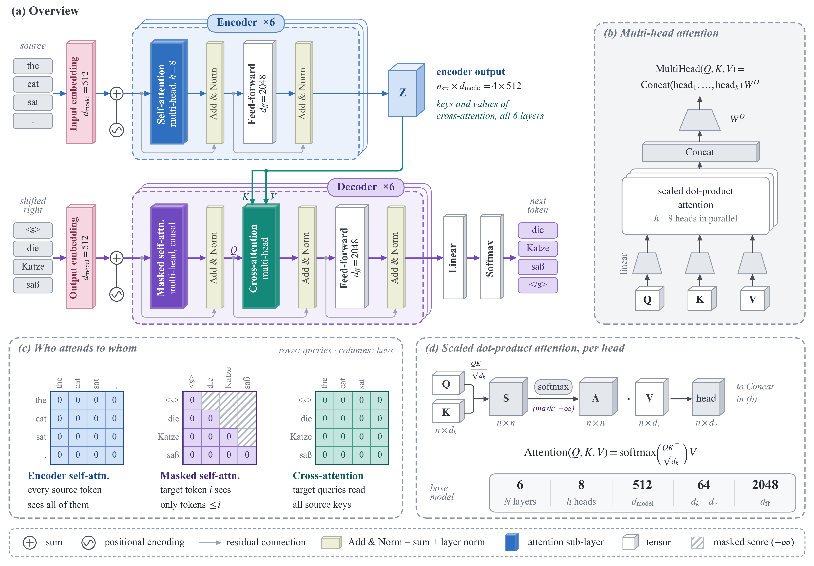

## Installation

```bash
# Skills CLI (Claude Code, Codex and other agents)
npx skills@latest add zichuanxu/cs-paper-figure-skill

# Claude Code plugin
claude plugin marketplace add zichuanxu/cs-paper-figure-skill
claude plugin install cs-paper-figure@cs-paper-figure-skill

# Codex plugin
codex plugin marketplace add zichuanxu/cs-paper-figure-skill
codex plugin add cs-paper-figure@cs-paper-figure-skill
```

Or copy `skills/cs-paper-figure` into `~/.claude/skills/`. The scripts need Python ≥ 3.10 with `matplotlib`, `numpy` and `pillow`.

## Usage

Ask your agent in plain language:

- "Redesign Figure 2 of this paper."
- "Draw the architecture figure from Section 3 at 170 mm width."
- "Critique this figure and fix the worst problems."

Every gallery figure has a script you can run:

```bash
cd skills/cs-paper-figure
python scripts/examples/transformer/render_fig1.py --out out
```

## Gallery

Each redesign keeps the paper's components, values and notation; only the drawing changes.

### The Transformer, Figure 1 ([arXiv:1706.03762](https://arxiv.org/abs/1706.03762))

| Original | Redesign |
| --- | --- |
| 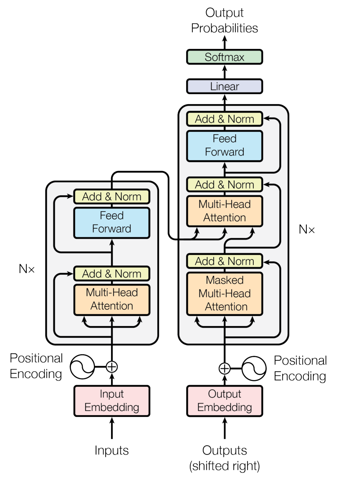 |  |

The three attention blocks are the only saturated blocks; side panels open one head with numbers and show the three uses as query-by-key matrices.

[PDF](gallery/transformer/transformer_fig1.pdf) · [source](skills/cs-paper-figure/scripts/examples/transformer/render_fig1.py)

### LoRA, Figure 1 ([arXiv:2106.09685](https://arxiv.org/abs/2106.09685))

| Original | Redesign |
| --- | --- |
|  | 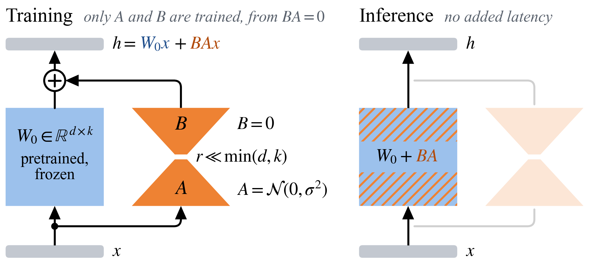 |

The layer is drawn twice, in training and at inference, so the merge W₀ + BA is a picture; the rank is the shape of the waist.

[PDF](gallery/lora/lora_fig1.pdf) · [source](skills/cs-paper-figure/scripts/examples/lora/render_fig1.py)

### ReAct, Figure 1 ([arXiv:2210.03629](https://arxiv.org/abs/2210.03629))

| Original | Redesign |
| --- | --- |
| 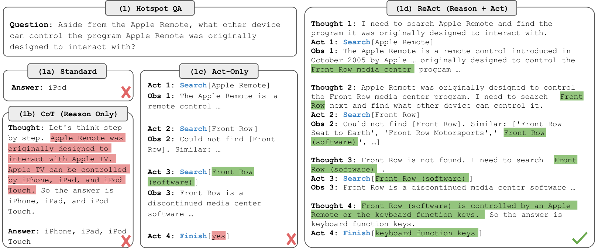 | 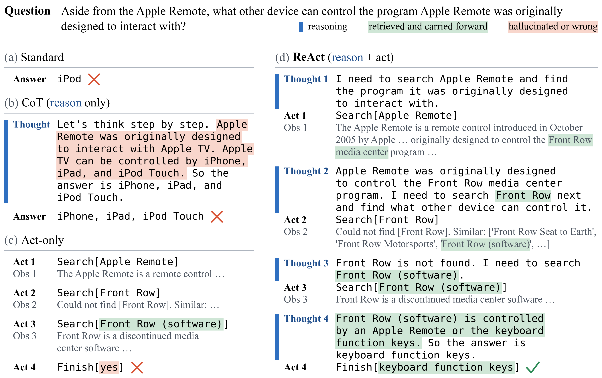 |

The HotpotQA example at 6.7 pt instead of 4.9 pt: the question once, a column per method, and the final answers on one line with their verdicts.

[PDF](gallery/react/react_fig1.pdf) · [full original](gallery/react/original/react_original_fig1.png) · [source](skills/cs-paper-figure/scripts/examples/react/render_fig1.py)

### Ray, Figure 7 ([arXiv:1712.05889](https://arxiv.org/abs/1712.05889))

| Original | Redesign |
| --- | --- |
|  |  |

Two node diagrams become one sequence chart: one step per row, and only the data-plane steps in colour.

[PDF](gallery/ray/ray_fig7_example.pdf) · [source](skills/cs-paper-figure/scripts/examples/ray/render_fig7.py)

### ReHarness, Figure 1 ([arXiv:2610.12668](https://arxiv.org/abs/2610.12668))

| Original | Redesign |
| --- | --- |
| 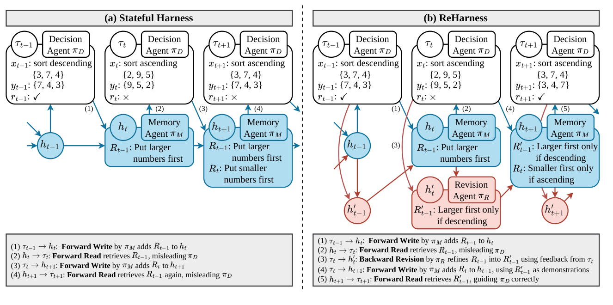 | 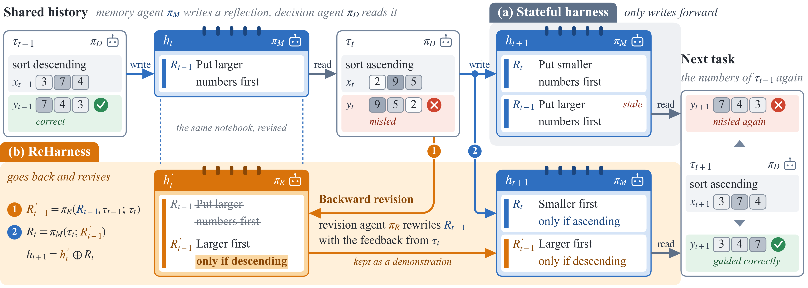 |

One history, two futures: the shared run is drawn once and forks at the failure, and "backward revision" is the one arrow that points left.

[PDF](gallery/reharness/reharness_fig1.pdf) · [source](skills/cs-paper-figure/scripts/examples/reharness/render_fig1.py)

### ToolSpace, Figure 1 ([arXiv:2611.05036](https://arxiv.org/abs/2611.05036))

| Original | Redesign |
| --- | --- |
|  |  |

One spine instead of four panels: the graph is drawn on the Tool Space plate, the walk is laid flat as a rail, and the task forks into the two results.

[PDF](gallery/toolspace/toolspace_fig1_overview.pdf) · [source](skills/cs-paper-figure/scripts/examples/toolspace/render_fig1.py)

### GroupAssistBench, Figures 1 and 2 ([arXiv:2611.04867](https://arxiv.org/abs/2611.04867))

| Original | Redesign |
| --- | --- |
|  | 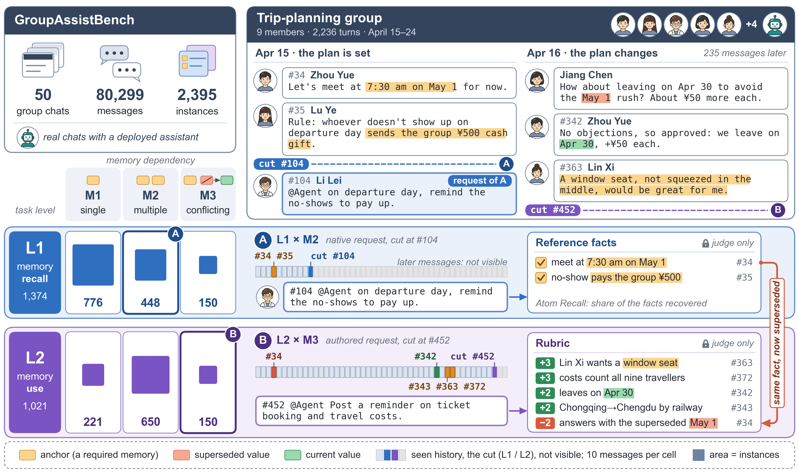 |
| 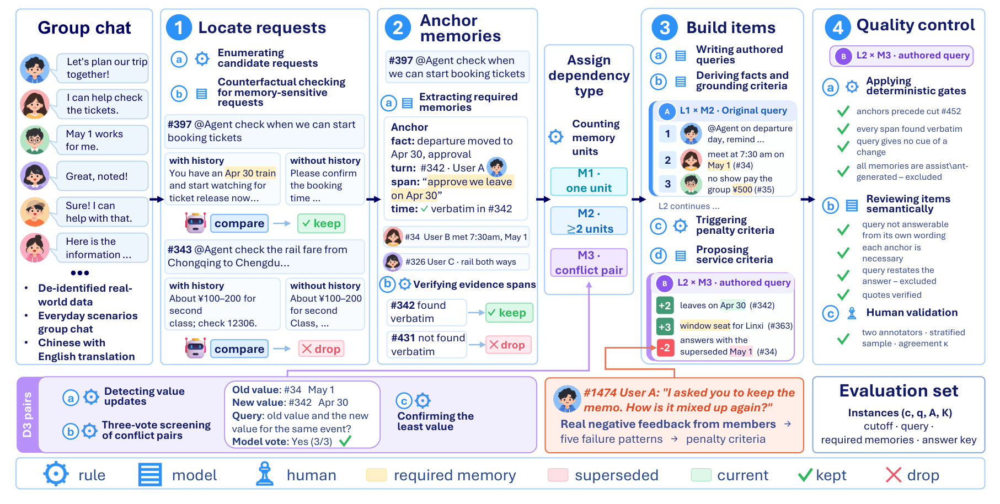 |  |

Each task level is a band that runs from its taxonomy row into a worked instance; the pipeline is also the funnel from 13,782 candidates to 2,395 instances.

[PDFs](gallery/groupassist/) · [source](skills/cs-paper-figure/scripts/examples/groupassist/)

### MemT-1.0, Figures 3 and 4 ([arXiv:2610.26825](https://arxiv.org/abs/2610.26825))

| Original | Redesign |
| --- | --- |
| 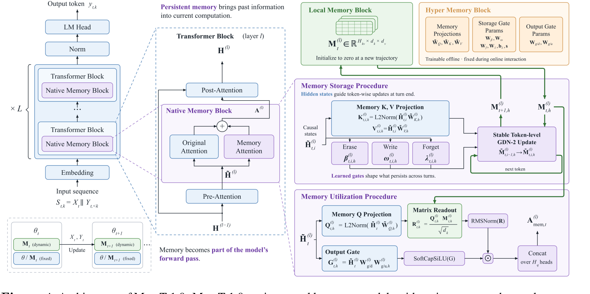 | 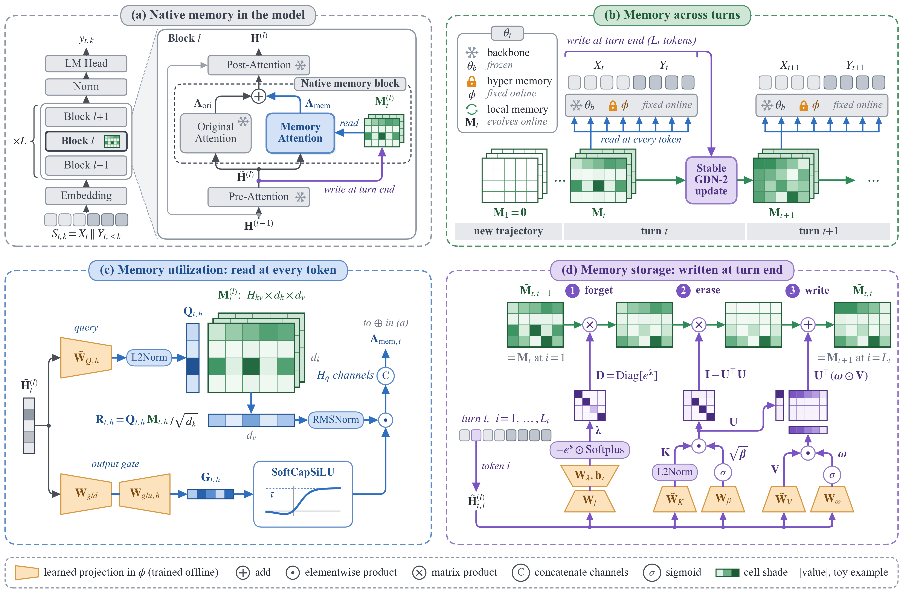 |
|  | 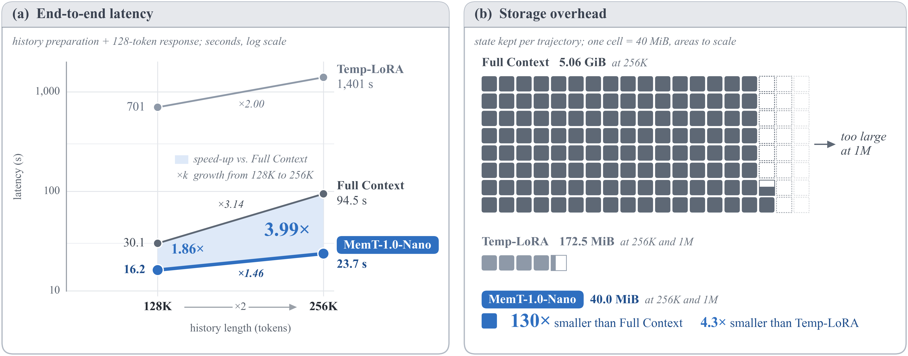 |

Four panels answer where the memory sits and how it is read and written; two bar panels become one slope chart with storage drawn to scale.

[Fig. 4 PDF](gallery/memt/memt_fig4_architecture.pdf) · [Fig. 3 PDF](gallery/memt/memt_fig3_efficiency.pdf) · [source](skills/cs-paper-figure/scripts/examples/memt/)

### One-column figures

| Idea schematic | Field chart |
| --- | --- |
|  | 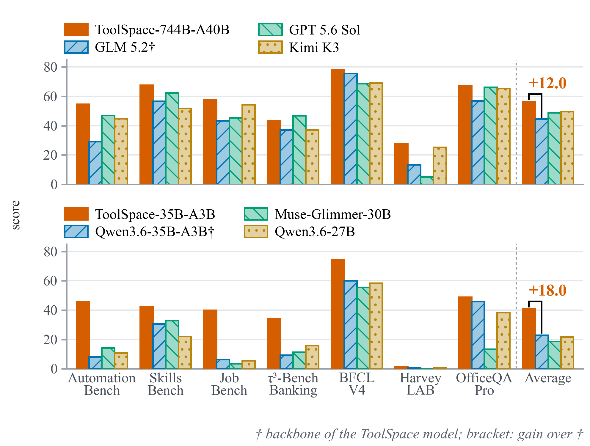 |

MemT-1.0's idea and ToolSpace's Table 1, each designed for an 84 mm column.

[PDFs](gallery/memt/) · sources: [schematic](skills/cs-paper-figure/scripts/examples/memt/render_idea_column.py), [chart](skills/cs-paper-figure/scripts/examples/toolspace/render_table1_column.py)

### Results figures

| Leaderboard with several measures | Quality against cost |
| --- | --- |
| 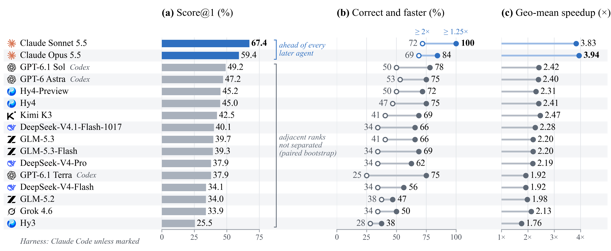 |  |


Accelerate Bench's Table 1 ([arXiv:2611.20882](https://arxiv.org/abs/2611.20882)) as row-aligned panels, a Pareto front (synthetic data) and a timing diagram (illustrative).

[PDFs](gallery/accelerate/) · sources: [leaderboard](skills/cs-paper-figure/scripts/examples/accelerate/render_table1_rows.py), [frontier](skills/cs-paper-figure/scripts/examples/pareto/render_frontier_column.py), [timing](skills/cs-paper-figure/scripts/examples/timing/render_speculation.py)

## License

[MIT](LICENSE), except the original figure crops in `gallery/*/original/`, each © its authors: MemT-1.0 (CC BY-NC-SA 4.0), GroupAssistBench and ReAct (CC BY 4.0), the Transformer (Google's permission for scholarly use with attribution), and ReHarness, ToolSpace, LoRA and Ray (reproduced for commentary and comparison; removed on request). The redesigns are independent demonstrations, not affiliated with the papers' authors. Product and model logos in the ToolSpace and Accelerate Bench examples are trademarks of their owners, used only to identify the products.
