# cs-paper-figure

An agent skill for designing, drawing and critiquing figures for computer-science research papers: method and architecture diagrams, agent/memory pipelines, efficiency and benchmark charts, ablations and worked examples. It is built from a close study of figures in recent papers from Google, Meta, Microsoft, NVIDIA, OpenAI, Anthropic, DeepSeek, Moonshot, Qwen/Alibaba and Tencent, and ships a small drawing library so the agent produces editable, reproducible vector figures rather than generic flowcharts.

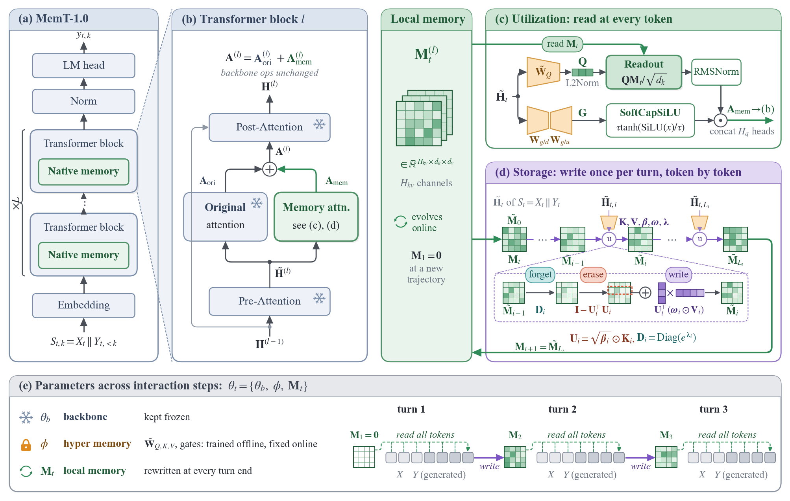

## What is inside

| Part | Purpose |
| --- | --- |
| [`SKILL.md`](cs-paper-figure/SKILL.md) | The workflow the agent follows: brief → references → structure → visual system → reproducible source → review → delivery |
| [`references/visual-craft.md`](cs-paper-figure/references/visual-craft.md) | The rulebook for *how it should look*: typography, role colour families, glyph vocabulary, composition patterns, connectors, density targets, chart craft, a beat-the-original protocol and an anti-pattern checklist |
| [`references/craft-study-2026-10.md`](cs-paper-figure/references/craft-study-2026-10.md) | The evidence behind those rules: readings of IdeaScientist and SkillOpt overview figures and measured fonts, colours, strokes and ink density of Gated DeltaNet, Kimi Linear, Titans, NSA, DeepSeek-V3, Hymba, BLT, Nemotron-H and others |
| [`scripts/paperkit.py`](cs-paper-figure/scripts/paperkit.py) | Drawing primitives in millimetres at printed size: cards, nodes, state matrices, vectors, trapezoid projections, ⊕/⊙ operators, token strips, documents, stacks, gates, icons (frozen / trainable / fixed / evolving), zoom rays, routed arrows, colour-coded equations, plus `density` and `compare` review commands |
| `scripts/examples/` | Reference figures with their render scripts: the MemT-1.0 redesigns and the five restyled examples below |
| `references/` (other files) | A 120-paper / 261-figure corpus of 2024–2026 papers, per-lab studies, figure patterns, scientific-integrity contract, export and review checks |

## Gallery

### MemT-1.0 redesign

The two figures below redesign Figures 3 and 4 of *MemT-1.0: Towards Memory-Native Evolution* ([arXiv:2610.26825](https://arxiv.org/abs/2610.26825); the originals are on pages 2 and 6). Every value, symbol and equation comes from the paper. An independent review agent checked both against the paper's text.

**Figure 4: architecture.** The original nests four zoom levels with crossing rays, draws the memory matrix, gates and update rule as text boxes, and leaves the key idea (memory evolving across turns) to a small inset. The redesign:
- uses one zoom step into the Transformer block;
- gives the memory state `M_t` its own column;
- separates the read path (every token, green) from the write path (once per turn, purple);
- draws one GDN-2 update step on the matrix itself (forget → erase → outer-product write) above its typeset equation;
- marks the offline-trained hyper-memory projections as amber trapezoids in place;
- adds a turn timeline for `θ_t = {θ_b, φ, M_t}`.

[PDF](gallery/memt/memt_fig4_architecture.pdf) · [source](cs-paper-figure/scripts/examples/memt/render_fig4.py)

**Figure 3: efficiency.** The original uses log-scale bars that start at an arbitrary floor, so bar length means nothing, and it never shows the ratios. The redesign:
- plots latency as a slope chart from 128K to 256K, with brackets for **3.99×** and **59×** faster;
- shows storage as an area-true waffle where one cell is the 40 MiB MemT memory: Full Context fills about 130 cells, Temp-LoRA 4.3 and MemT 1.

[PDF](gallery/memt/memt_fig3_efficiency.pdf) · [source](cs-paper-figure/scripts/examples/memt/render_fig3.py)

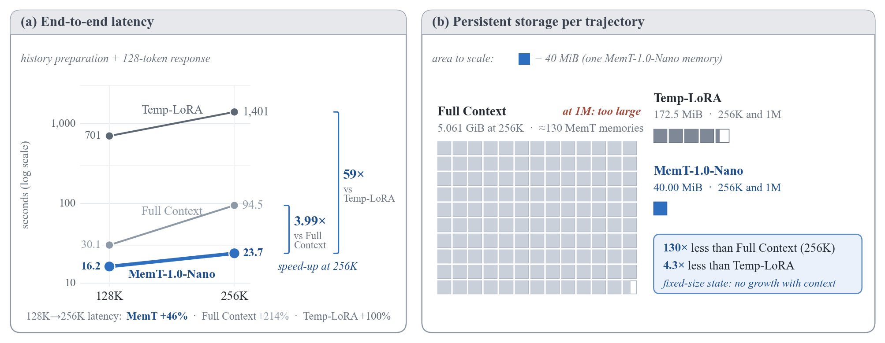

### Five worked examples: before → after

"Before" is what the previous version of this skill produced; "after" is the same scientific content rebuilt with `paperkit` and `visual-craft.md`. All values are re-read from the original fixtures and asserted in the render scripts. All five use illustrative fixtures or synthetic data, not real benchmark results.

| | Before | After |
| --- | --- | --- |
| **Method**: evidence-guided memory refinement | 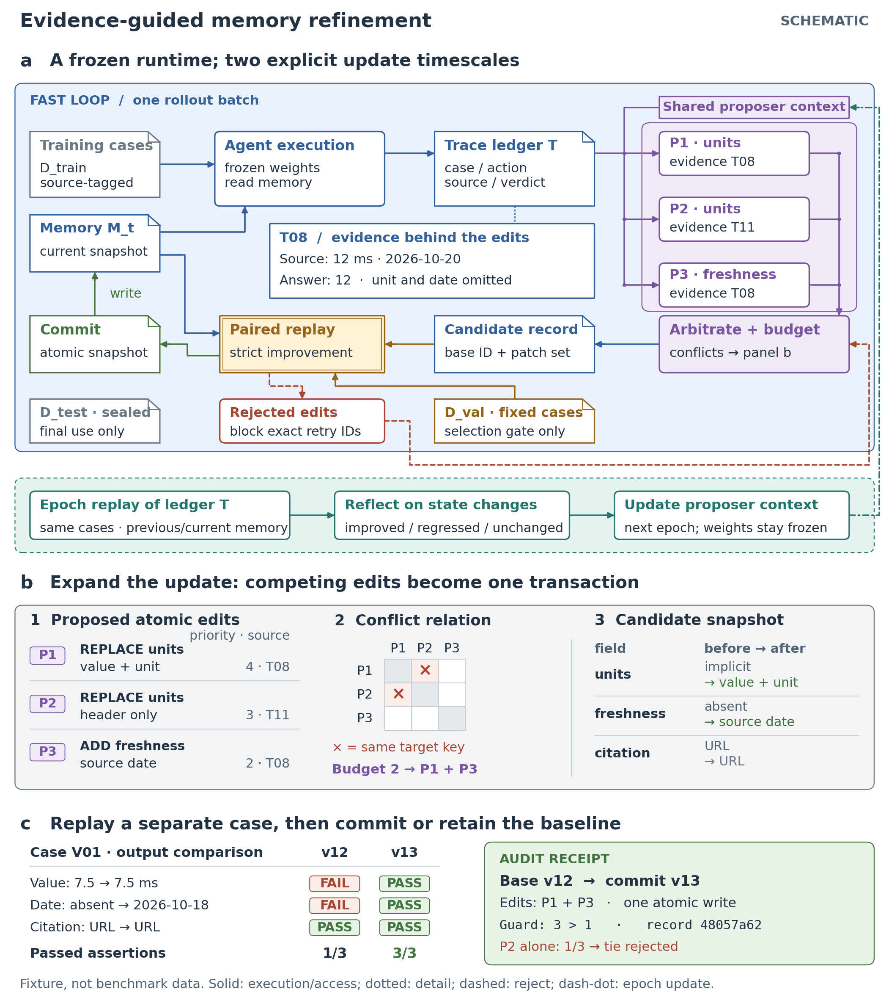 | 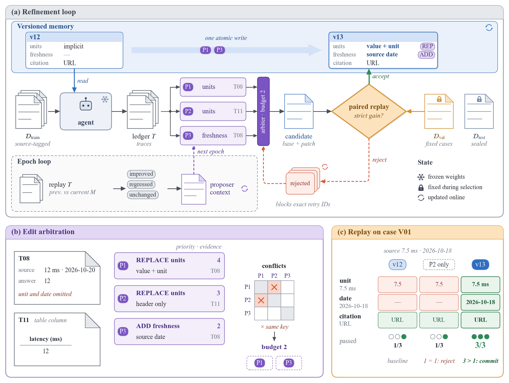 |
| **Attention**: causal cache mask and worked readout | 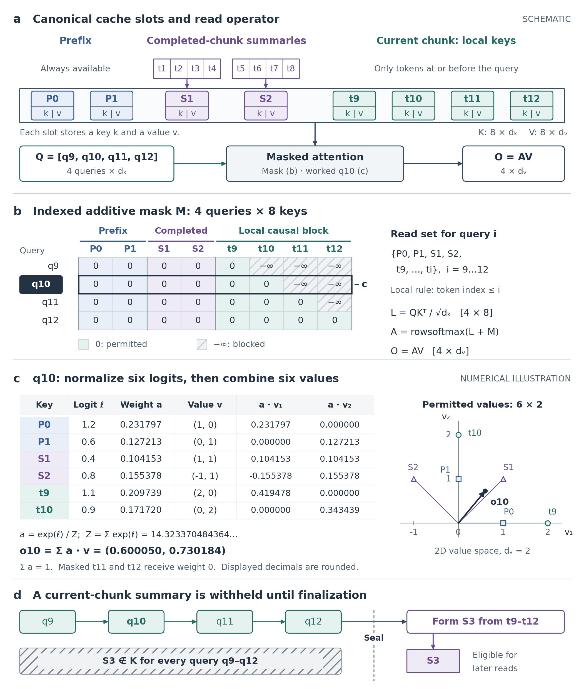 | 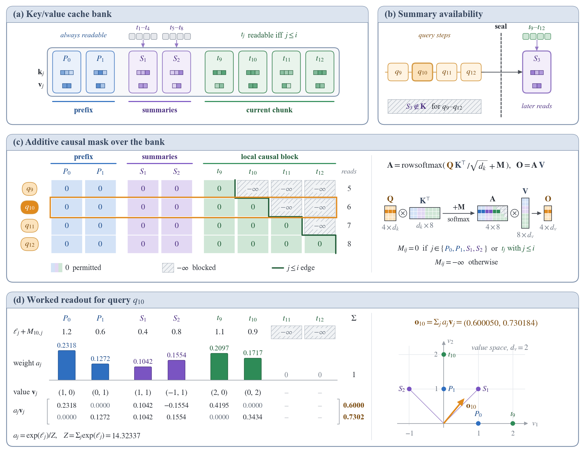 |
| **Experiment**: paired effects, heterogeneity, cost, diagnostics | 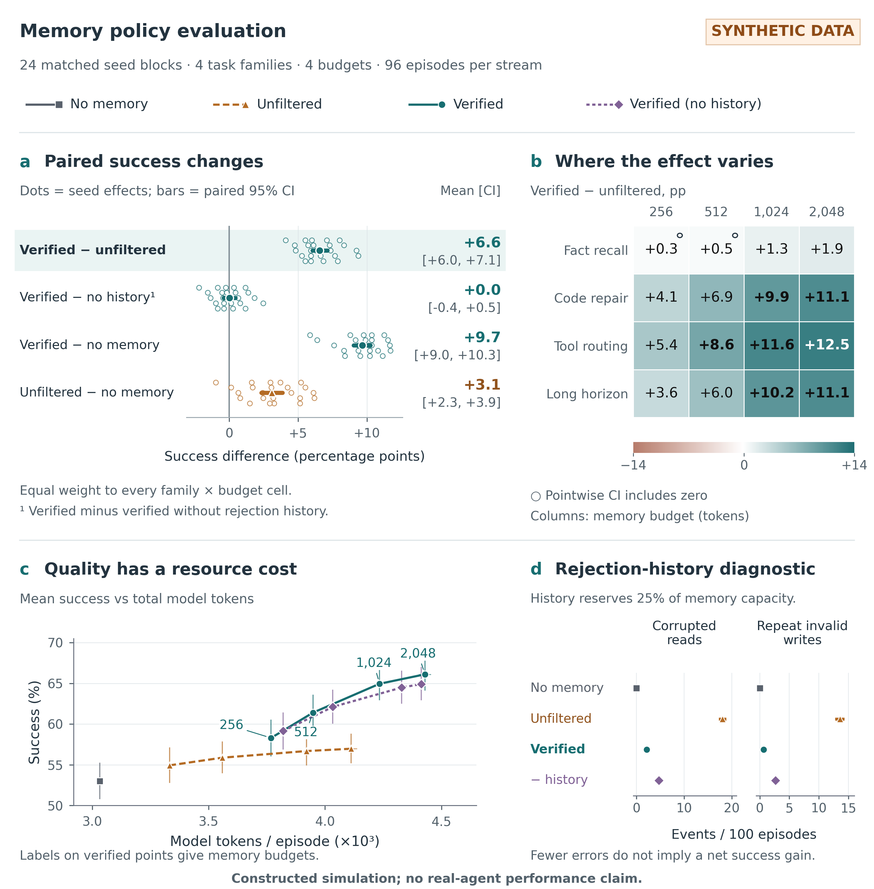 | 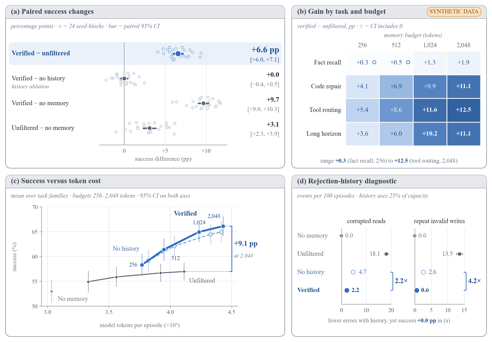 |
| **Scene planning**: candidate rollouts, swept collision, executed step | 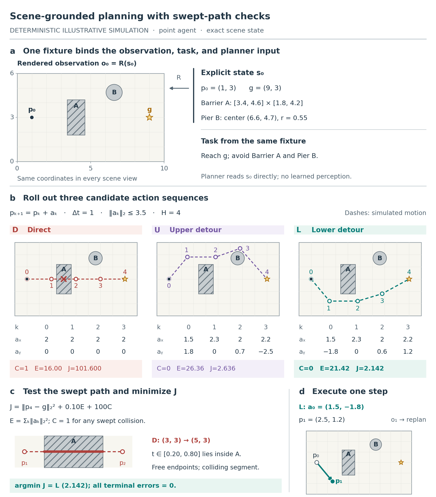 | 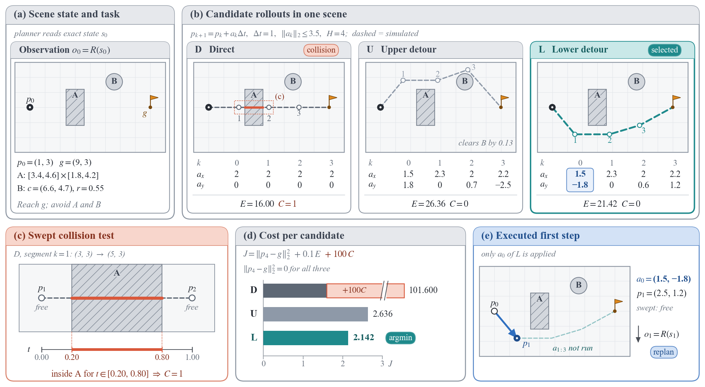 |
| **Epoch context**: replay groups and context update | 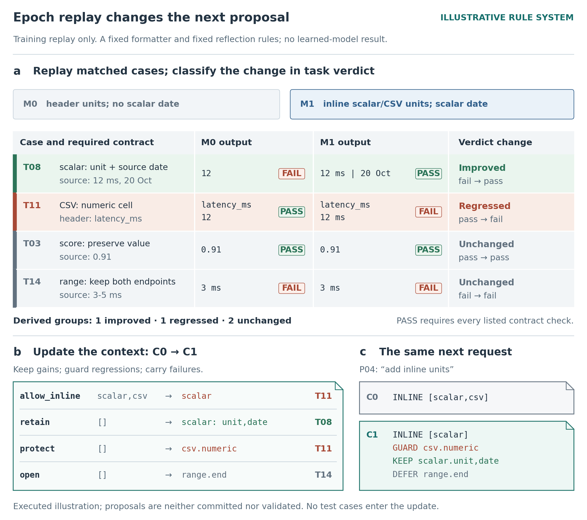 | 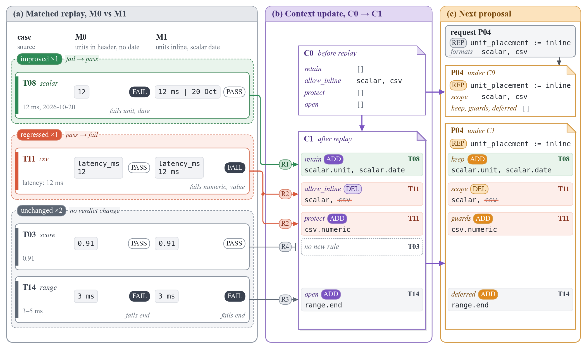 |

Full-size PDFs: [method](gallery/after/method.pdf) · [attention](gallery/after/attention.pdf) · [experiment](gallery/after/experiment.pdf) · [scene planning](gallery/after/scene-planning.pdf) · [epoch context](gallery/after/epoch-context.pdf)

## Installation

Copy the skill folder into your agent's skills directory. For Claude Code:

```bash
git clone https://github.com/zichuanxu/cs-paper-figure-skill.git
cp -R cs-paper-figure-skill/cs-paper-figure ~/.claude/skills/
```

Python requirements for the scripts: Python ≥ 3.10, `matplotlib`, `numpy` and `pillow`. Fonts are matched to the manuscript: Times New Roman when installed, otherwise the STIX fonts bundled with matplotlib. `pymupdf` and Poppler are optional, for inspecting source PDFs.

```bash
pip install matplotlib numpy pillow
```

## Usage

Ask your agent in plain language. For example:

- "Draw the architecture figure for our method from Section 3 at 170 mm width."
- "Redesign Figure 2 of this paper and beat it."
- "Critique this figure and fix the most important problems."
- "Make a headline efficiency figure from these latency and memory numbers."

The skill states a five-second message and a hero element, picks a composition pattern, builds the figure with `paperkit` at printed size, exports PDF/SVG/PNG with embedded fonts, and reviews the render for overlaps, density and faithfulness.

Render the reference figures yourself:

```bash
cd cs-paper-figure
python scripts/examples/memt/render_fig4.py --out out
python scripts/examples/memt/render_fig3.py --out out
python scripts/examples/restyled/render_attention.py --out out   # also: method, experiment, scene_planning, epoch_context
python scripts/paperkit.py density out/memt_fig4_architecture.png
python scripts/paperkit.py compare original.png out/new.png side_by_side.png
```

## Design rules in brief

1. Decide the five-second message; make one hero element carry it.
2. Match the manuscript font (Times/STIX with STIX math for LaTeX papers), at three sizes, with nothing below 6 pt.
3. Give each colour role a family (pale fill, same-hue stroke, dark same-hue text) with one meaning. Use 3–5 hues, novel parts saturated and inherited parts neutral.
4. Draw the noun: matrices as grids, projections as trapezoids, element-wise operations as ⊕/⊙ circles, tokens as strips, artifacts as documents.
5. Limit each canvas to two zoom levels. Give persistent state its own column, with read and write paths kept separate.
6. Use orthogonal, dark-neutral arrows, coloured only when colour encodes the path type. Avoid crossings and wires longer than 45 mm.
7. Label in noun phrases. Put narrative, status labels and caveats in the caption.
8. In charts, give the method a hero colour and baselines grey. Label directly, make ratios visible, and use area-true encodings. Never put bars on a log axis.
9. Every number comes from the inputs, and derived numbers are asserted in code.
10. Render and inspect the result, then iterate. A side-by-side with the original should show a clear win.

## Notes

- The MemT figures are an independent redesign for demonstration; this project is not affiliated with the MemT-1.0 authors. See the paper for the original figures and results.
- The paper corpus in `references/` records design observations with figure anchors; it does not redistribute other papers' artwork.
