# cs-paper-figure

An agent skill for designing, drawing and critiquing figures for computer-science papers: architecture and method diagrams, agent pipelines, efficiency and benchmark charts. It is distilled from a close study of figures in leading AI research papers and ships a small drawing library so the agent produces editable, reproducible vector figures instead of generic flowcharts.


<sub>The Transformer (*Attention Is All You Need*, Figure 1), redesigned with this skill.</sub>

## What is inside

| Part | Purpose |
| --- | --- |
| [`SKILL.md`](skills/cs-paper-figure/SKILL.md) | The workflow: brief → references → structure → visual system → reproducible source → review |
| [`visual-craft.md`](skills/cs-paper-figure/references/visual-craft.md) | How it should look: typography, role colours, glyph vocabulary, composition, connectors, density, charts, anti-patterns |
| [`paperkit.py`](skills/cs-paper-figure/scripts/paperkit.py) | Drawing primitives in millimetres at print size (cards, matrices, trapezoids, ⊕/⊙, tokens, documents, icons, routed arrows, typeset math) plus `density` and `compare` checks |
| [`figure-series.md`](skills/cs-paper-figure/references/figure-series.md) | Figure series for surveys and frameworks: one taxonomy palette, chapter frames, running examples, gate stacks, spectra, illustrated scenes with vector dialogue |
| [`codex_icons.py`](skills/cs-paper-figure/scripts/codex_icons.py) + [`image-generation.md`](skills/cs-paper-figure/references/image-generation.md) | Optional matched icon sets generated with Codex CLI |
| `scripts/examples/`, `references/` | The gallery's render scripts; a 120-paper figure corpus, per-lab studies and review checklists |

## Gallery

Each redesign keeps the paper's components, values and notation; only the drawing changes.

### The Transformer, Figure 1 ([arXiv:1706.03762](https://arxiv.org/abs/1706.03762))

| Original | Redesign |
| --- | --- |
|  |  |

- The three attention kinds get their own colours, and panel (b) draws each as its mask (full, causal, target × source).
- K and V enter cross-attention from the encoder, Q from the decoder; "shifted right" is shown with real token strips.
- Multi-head attention, the two equations and the base-model hyperparameters fit into the same figure.

[PDF](gallery/transformer/transformer_fig1.pdf) · [source](skills/cs-paper-figure/scripts/examples/transformer/render_fig1.py)

### Harness², Figures 2 and 3 ([arXiv:2610.14224](https://arxiv.org/abs/2610.14224))

| Original | Redesign |
| --- | --- |
|  |  |
|  |  |

- Fig. 2: the eight components as editable files around a frozen model, with the tool loop through the plugin hook and delegation to a subagent.
- Fig. 3: two bands forming one cycle — Propose → Probe (contrast with e₀) → Compose with the paper's four decisions, and the reflector updating the library.
- One icon family generated with the skill's Codex helper replaces the mixed clipart; `--vector-icons` renders without it.

[Fig. 2 PDF](gallery/harness2/harness2_fig2_components.pdf) · [Fig. 3 PDF](gallery/harness2/harness2_fig3_pipeline.pdf) · [source](skills/cs-paper-figure/scripts/examples/harness2/)

### A figure series: *Proactive AI for Superintelligent Agents*

Six figures of a 15-figure survey ([PDF](https://storage.googleapis.com/gweb-research2023-media/pubtools/1048480.pdf)) rebuilt as one series. The paper threads a six-capacity framework (Awareness, Anticipation, Agenda, Arbitration, Action, Adaptation) through nine figures but re-picks each capacity's colour per figure (Agenda is pink, purple and blue); here one palette is defined once (`paperkit.series`) and every figure imports it. Illustrations come from the skill's Codex helper as one cast with no text in the pixels; every word is vector text.

| | Original | Redesign |
| --- | --- | --- |
| **Fig. 1**, proactive vs. reactive | 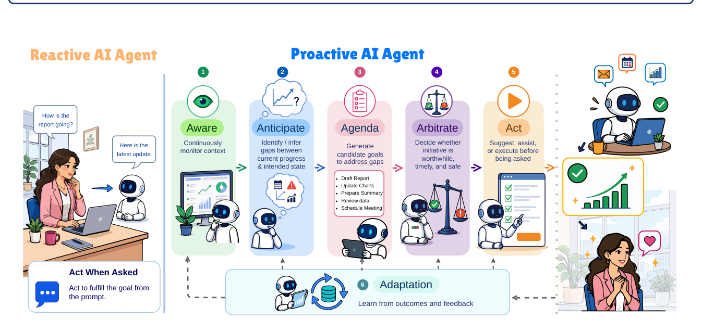 | 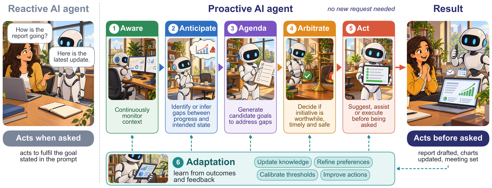 |
| **Fig. 3**, capabilities to earned autonomy | 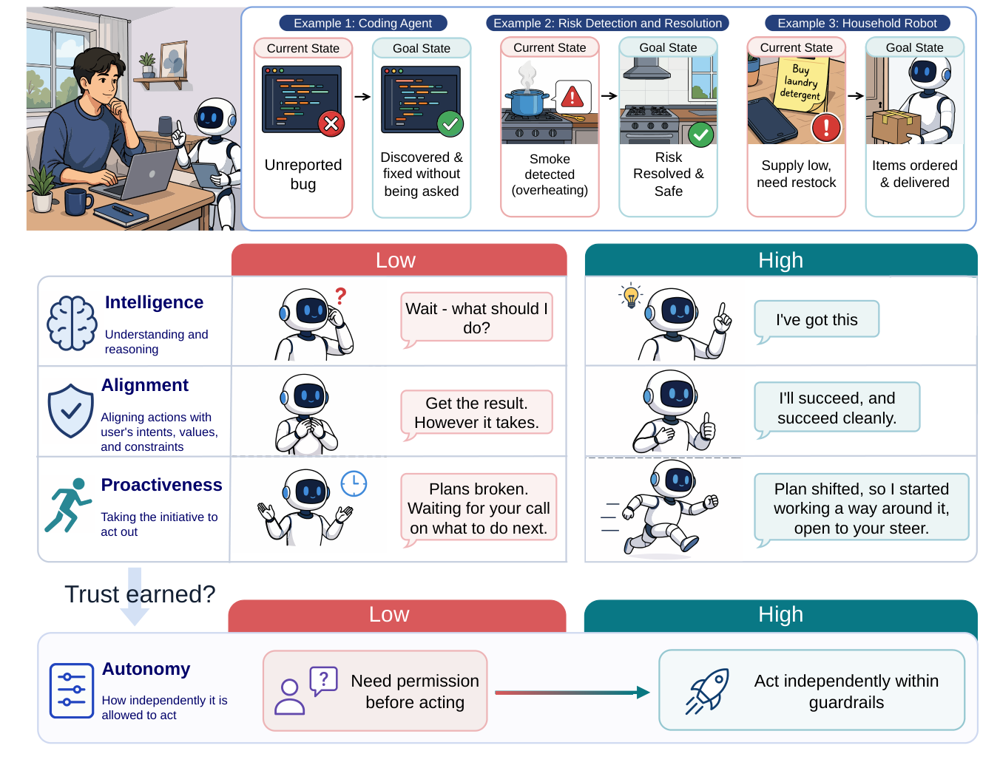 | 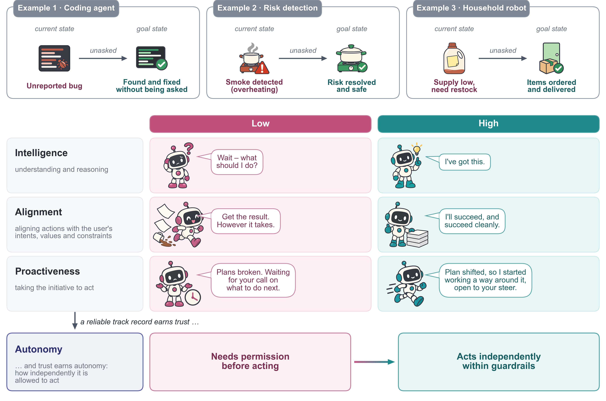 |
| **Fig. 4**, the reactivity–proactivity spectrum | 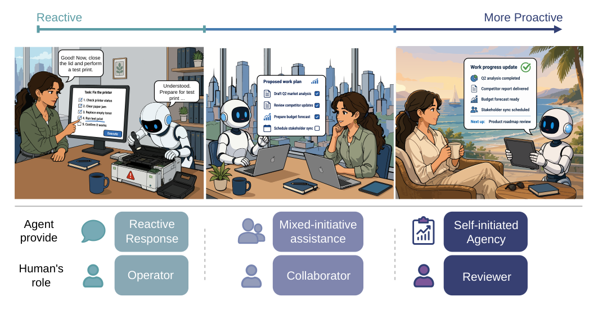 | 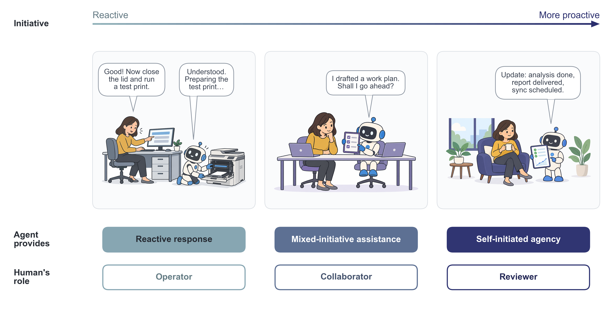 |
| **Fig. 5**, historical foundations | 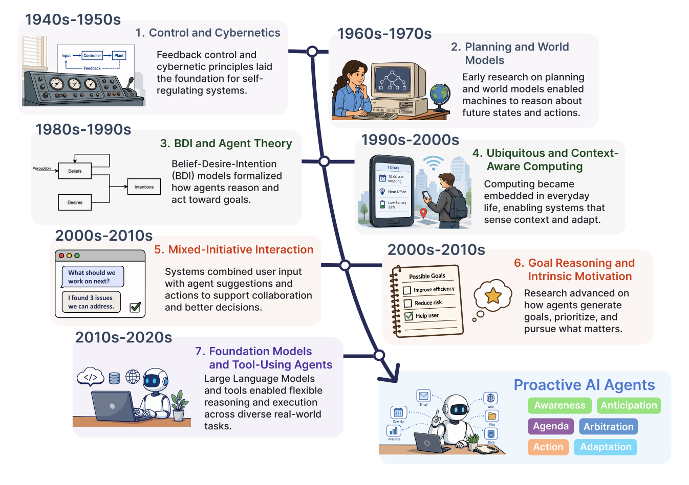 | 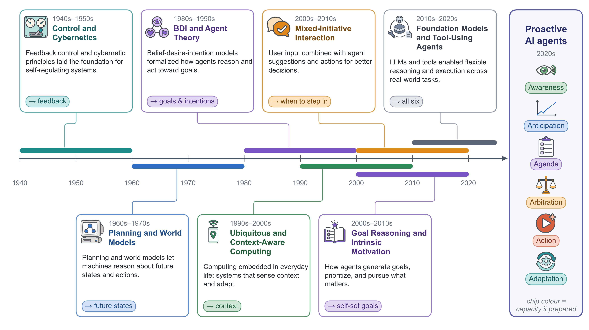 |
| **Fig. 6**, the six capacities | 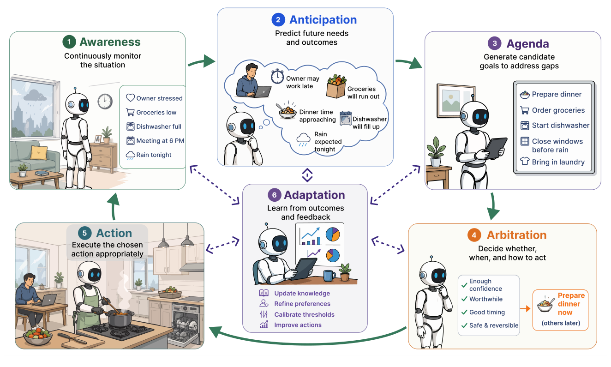 | 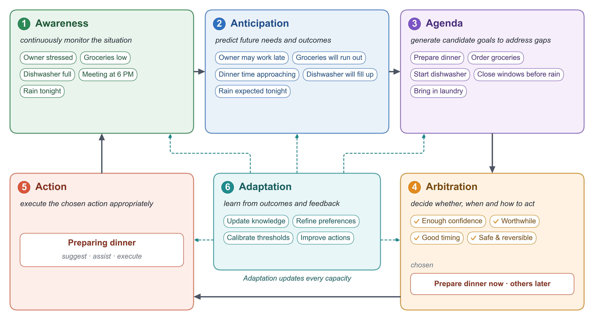 |
| **Fig. 10**, arbitration | 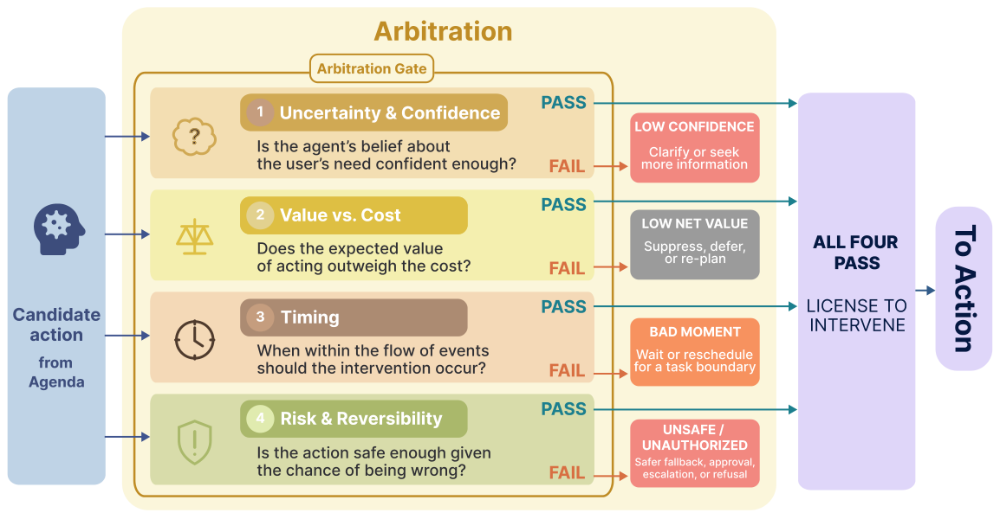 | 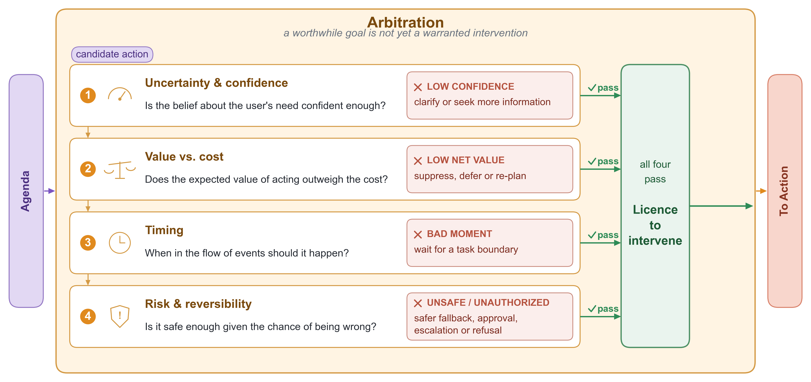 |

- Fig. 1: the left column shows what the user experiences (asked vs. unasked); the right shows how the agent gets there, five stages in their series colours with Adaptation feeding all of them.
- Fig. 3: the three examples become current → goal state pairs; the low/high grid keeps the paper's lines as speech bubbles with tails on one robot cast; autonomy is granted as the track record earns trust.
- Fig. 5: a proportional time axis instead of evenly spaced zig-zag cards; each era is a span with a leader to its card, and its chip names what it handed on, in the colour of the capacity it prepared.

[PDFs](gallery/proactive/) · [source](skills/cs-paper-figure/scripts/examples/proactive/) · [what the studies found](skills/cs-paper-figure/references/figure-series.md)

### ReHarness, Figure 1 ([arXiv:2610.12668](https://arxiv.org/abs/2610.12668))

| Original | Redesign |
| --- | --- |
| 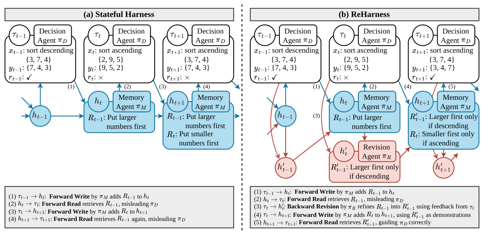 | 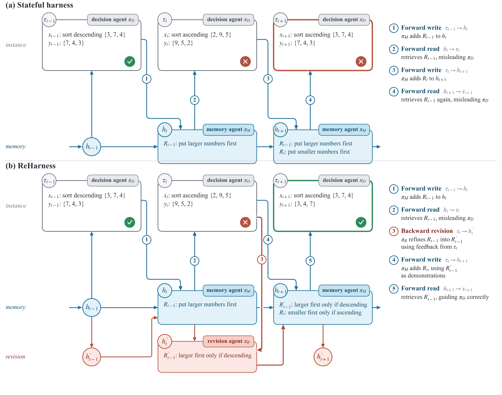 |

- Both panels share one column grid and the same sorting example, so the eye compares straight down; the revision layer exists only in (b), in its own row and colour.
- Edge numbers sit on their edges, the typed-edge legend sits beside each panel, and the one unavoidable crossing is drawn as a bridge.
- The outcome that changes, τ<sub>t+1</sub> going from wrong to right, is marked by the card border.

[PDF](gallery/reharness/reharness_fig1.pdf) · [source](skills/cs-paper-figure/scripts/examples/reharness/render_fig1.py)

### PaperBanana, Figure 5 ([arXiv:2601.23265](https://arxiv.org/abs/2601.23265))

| Original | Redesign |
| --- | --- |
| 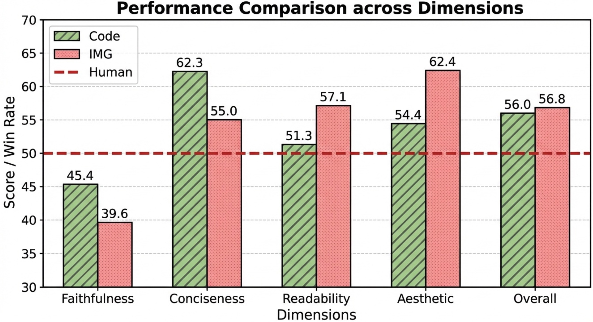 | 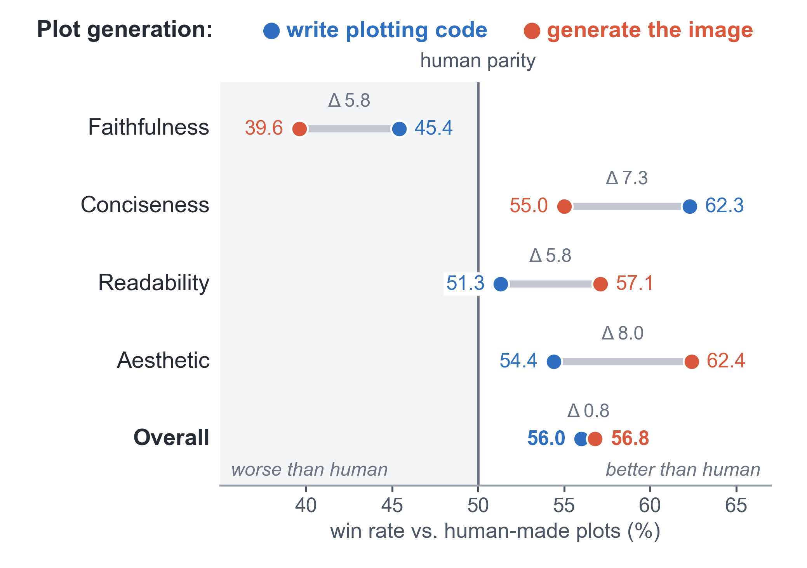 |

Grouped bars on an axis starting at 30 become dumbbells on an axis centred on human parity: the gap per dimension is labelled, the losing side is shaded, and the two findings read at once (code wins faithfulness and conciseness, image generation wins readability and aesthetics; only faithfulness is below parity). [PDF](gallery/paperbanana/paperbanana_fig5.pdf) · [source](skills/cs-paper-figure/scripts/examples/paperbanana/render_fig5.py)

### MemT-1.0, Figures 3 and 4 ([arXiv:2610.26825](https://arxiv.org/abs/2610.26825))

| Original | Redesign |
| --- | --- |
|  |  |
|  |  |

- Architecture: one zoom step instead of four, the memory state in its own column, one meaning per colour (grey frozen, teal state, blue read, violet write, amber φ).
- Efficiency: no bars on a log axis; a slope chart with visible ratios (3.99×, 59×) and an area-true waffle for storage.

[Fig. 4 PDF](gallery/memt/memt_fig4_architecture.pdf) · [Fig. 3 PDF](gallery/memt/memt_fig3_efficiency.pdf) · [source](skills/cs-paper-figure/scripts/examples/memt/)

### Five more examples

Illustrative fixtures or synthetic data, not real benchmark results.

| | Before | After |
| --- | --- | --- |
| **Method** |  |  |
| **Attention** |  |  |
| **Experiment** |  |  |
| **Scene planning** |  |  |
| **Epoch context** |  |  |

## Installation

```bash
# 1. Skills CLI (Claude Code, Codex and other agents)
npx skills@latest add zichuanxu/cs-paper-figure-skill

# 2. Claude Code plugin
claude plugin marketplace add zichuanxu/cs-paper-figure-skill
claude plugin install cs-paper-figure@cs-paper-figure-skill

# 3. Codex plugin
codex plugin marketplace add zichuanxu/cs-paper-figure-skill
codex plugin add cs-paper-figure@cs-paper-figure-skill
```

Or copy `skills/cs-paper-figure` into `~/.claude/skills/`. The scripts need Python ≥ 3.10 with `matplotlib`, `numpy` and `pillow`.

## Usage

Ask your agent in plain language, for example "Redesign Figure 2 of this paper and beat it", "Draw the architecture figure from Section 3 at 170 mm width" or "Critique this figure and fix the worst problems".

To render the gallery yourself:

```bash
cd skills/cs-paper-figure
python scripts/examples/transformer/render_fig1.py --out out
python scripts/examples/harness2/render_fig2.py --out out
python scripts/paperkit.py compare original.png out/new.png side_by_side.png
```

**Generated icons (optional).** With [Codex CLI](https://github.com/openai/codex) installed and logged in, `scripts/codex_icons.py` generates a matched icon set from one JSON spec and records the prompt for disclosure. Without Codex the skill uses its vector icons.

```bash
python scripts/codex_icons.py check
python scripts/codex_icons.py generate icons.json --out out/icons [--ref existing_icon.png]
```

## Design rules in brief

1. One five-second message, carried by one hero element.
2. The manuscript's font at three sizes, nothing below 6 pt.
3. 3–5 colour roles, one meaning each; new parts saturated, inherited parts neutral.
4. Draw the noun: grids for matrices, trapezoids for projections, strips for tokens.
5. Orthogonal arrows, no crossings; narrative goes in the caption.
6. Charts: direct labels, visible ratios, area-true encodings.
7. Every number comes from the inputs and is asserted in code.
8. Icons, if any: one matched set, labelled, never carrying text or data.

## License

[MIT](LICENSE), except the original figure crops in `gallery/*/original/`, each © its authors: MemT-1.0 (CC BY-NC-SA 4.0), Harness² and PaperBanana (CC BY 4.0), the Transformer (reproduced under Google's permission for scholarly use with attribution), and *Proactive AI for Superintelligent Agents* and ReHarness (reproduced for commentary and comparison; removed on request). All redesigns are independent demonstrations, not affiliated with the papers' authors.
