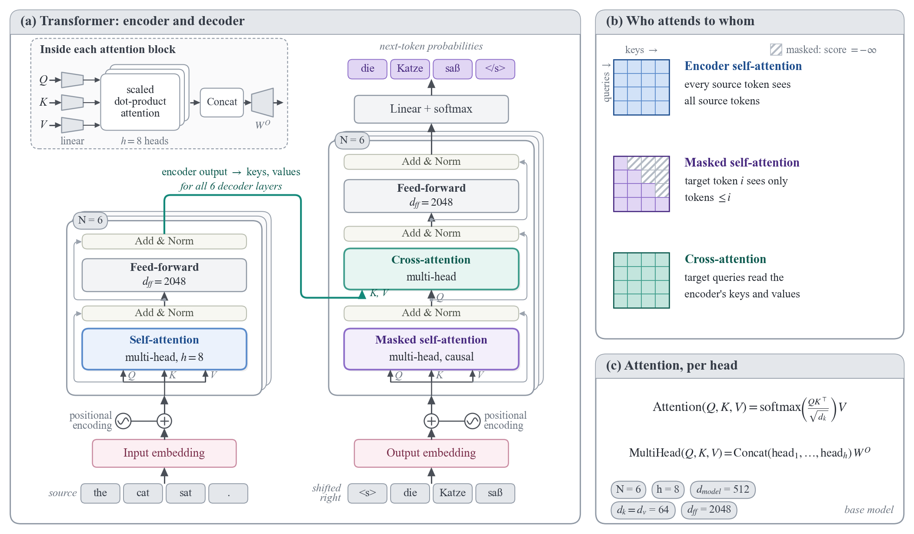
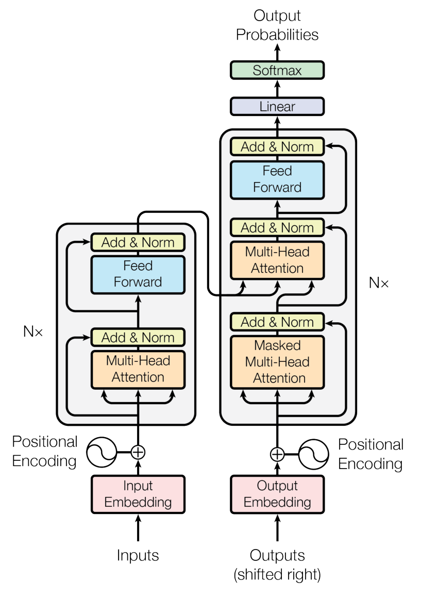
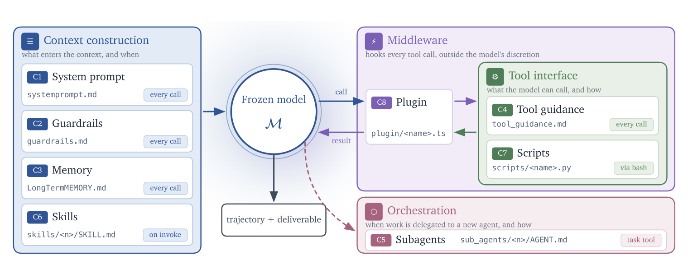
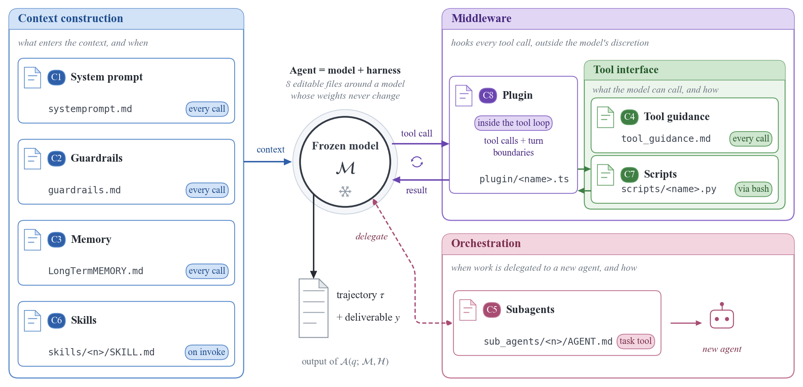
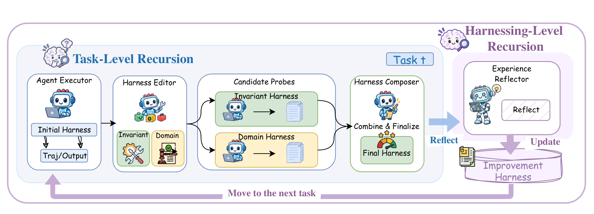
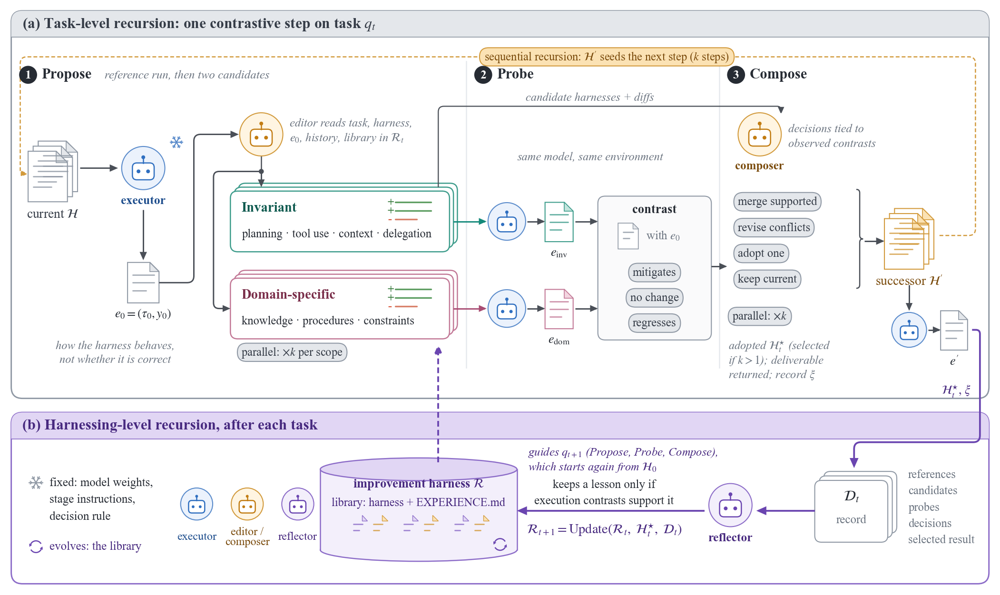
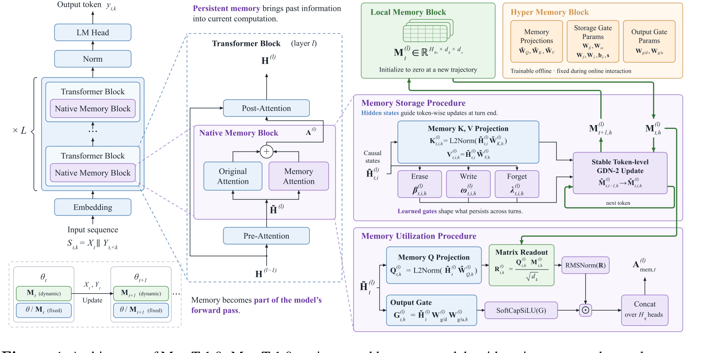
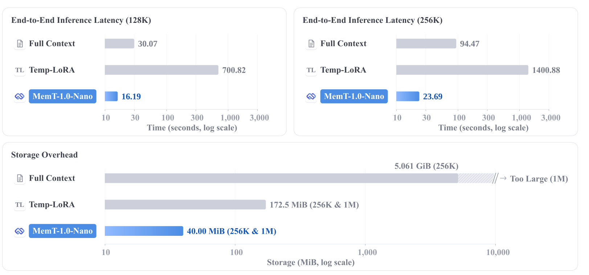

# cs-paper-figure

An agent skill for designing, drawing and critiquing figures for computer-science research papers: method and architecture diagrams, agent/memory pipelines, efficiency and benchmark charts, ablations and worked examples. It is built from a close study of figures in recent papers from Google, Meta, Microsoft, NVIDIA, OpenAI, Anthropic, DeepSeek, Moonshot, Qwen/Alibaba and Tencent, and ships a small drawing library so the agent produces editable, reproducible vector figures rather than generic flowcharts.



<sub>The Transformer from *Attention Is All You Need*, Figure 1, redesigned with this skill. See the [comparison with the original](#the-transformer-attention-is-all-you-need-figure-1).</sub>

## What is inside

| Part | Purpose |
| --- | --- |
| [`skills/cs-paper-figure/SKILL.md`](skills/cs-paper-figure/SKILL.md) | The workflow the agent follows: brief → references → structure → visual system → reproducible source → review → delivery |
| [`references/visual-craft.md`](skills/cs-paper-figure/references/visual-craft.md) | The rulebook for *how it should look*: typography, role colour families, glyph vocabulary, composition patterns, connectors, density targets, chart craft, a beat-the-original protocol and an anti-pattern checklist |
| [`references/craft-study-2026-10.md`](skills/cs-paper-figure/references/craft-study-2026-10.md) | The evidence behind those rules: readings of IdeaScientist and SkillOpt overview figures and measured fonts, colours, strokes and ink density of Gated DeltaNet, Kimi Linear, Titans, NSA, DeepSeek-V3, Hymba, BLT, Nemotron-H and others |
| [`scripts/paperkit.py`](skills/cs-paper-figure/scripts/paperkit.py) | Drawing primitives in millimetres at printed size: cards, nodes, state matrices, vectors, trapezoid projections, ⊕/⊙ operators, token strips, documents, stacks, gates, icons (frozen / trainable / fixed / evolving), zoom rays, routed arrows, colour-coded equations, plus `density` and `compare` review commands |
| `scripts/examples/` | Reference figures with their render scripts: the Transformer, Harness² and MemT-1.0 redesigns and the five restyled examples below |
| `references/` (other files) | A 120-paper / 261-figure corpus of 2024–2026 papers, per-lab studies, figure patterns, scientific-integrity contract, export and review checks |

## Gallery

### The Transformer (*Attention Is All You Need*, Figure 1)

A redesign of the most-reproduced architecture figure in deep learning ([arXiv:1706.03762](https://arxiv.org/abs/1706.03762), page 3). Every component and hyperparameter comes from Section 3 of the paper; the example tokens are illustrative.

| Original (Vaswani et al., 2017) | Redesigned with this skill |
| --- | --- |
|  |  |

| | Original | Redesign |
| --- | --- | --- |
| The three attention kinds | All three drawn in the same orange | Each kind has its own colour (encoder self-attention blue, masked self-attention violet, cross-attention teal), and those are the only saturated colours |
| Masking and cross-attention | Only the word "Masked" and an unlabeled wire | Panel (b) draws each pattern as a 4×4 mask in the matching colour: full, causal with hatched −∞ cells, and target × source |
| Encoder → decoder link | A wire into the middle block | A teal path labelled "encoder output → keys, values", entering the cross-attention as K, V, while Q comes from below |
| "Shifted right" | A text label | Real token strips: `<s> die Katze saß` in, `die Katze saß </s>` out, aligned so the shift is visible |
| Multi-head attention | A separate figure (Fig. 2) | An inset (projections → h = 8 heads → concat → W^O), plus the two equations and the base-model hyperparameters in panel (c) |
| Stacks of N = 6 | "N×" beside the box | Offset stacked cards with an "N = 6" chip |
| Add & Norm | Yellow boxes as heavy as the sublayers | Slim neutral bars, with residual paths in light grey |

[PDF](gallery/transformer/transformer_fig1.pdf) · [source](skills/cs-paper-figure/scripts/examples/transformer/render_fig1.py)

The original figure is reproduced under the paper's notice: "Provided proper attribution is provided, Google hereby grants permission to reproduce the tables and figures in this paper solely for use in journalistic or scholarly works." Source: Vaswani et al., *Attention Is All You Need*, NeurIPS 2017.

### Harness² (Figures 2 and 3)

Redesigns of Figures 2 and 3 of *Harness²: Recursive Agent Harnessing for an Open World* ([arXiv:2610.14224](https://arxiv.org/abs/2610.14224), pages 3 and 5). All components, files, stages and symbols come from Sections 2.1–2.3. The original Figure 2 is one of the skill's own reference figures, so this tests whether the skill can improve on a strong baseline.

#### Figure 2: the eight harness components

| Original (Harness² paper) | Redesigned with this skill |
| --- | --- |
|  |  |

| | Original | Redesign |
| --- | --- | --- |
| The agent loop | Call/result arrows only; the order is left implicit | Numbered steps ① context → ② tool call → ③ plugin hook into the tool → ④ result → ⑤ trajectory and deliverable |
| Frozen vs editable | A glowing circle | Model marked frozen (snowflake); every component drawn as an editable file with its ID, path and activation |
| Delegation | A dashed arrow into the Orchestration box | A dashed "delegate" route into C5, which spawns a "new agent" |
| Decoration | Soft blue glow behind the model | Removed; one quiet halo ring |

[PDF](gallery/harness2/harness2_fig2_components.pdf) · [source](skills/cs-paper-figure/scripts/examples/harness2/render_fig2.py)

#### Figure 3: the recursive pipeline

| Original (Harness² paper) | Redesigned with this skill |
| --- | --- |
|  |  |

| | Original | Redesign |
| --- | --- | --- |
| Visual style | Mixed raster clipart, handwritten and serif fonts | One vector icon set: the executor, editor and reflector roles in fixed colours (blue, amber, violet); one serif typeface with typeset math |
| Structure | Two boxes joined by thick arrows | Two bands forming one cycle: the task level runs left to right through numbered stages (Reference → Propose → Probe → Compose), the harnessing level runs right to left, and the library sits under the Propose stage it feeds |
| Probe | Two rows with no outcome | Each candidate is run under the same model and environment and contrasted with e₀: mitigates / no change / regresses |
| Compose | "Combine & Finalize" and a gauge | The four decisions from the paper (merge supported, revise conflicts, adopt one, keep current) → successor H′ → e′ |
| Recursion forms | Not shown | ×k candidates per scope and ×k compositions (parallel); a dashed loop where H′ seeds the next step (sequential) |
| Library update | "Update" arrow to a cylinder | D_t → reflector (keeps lessons only if supported by contrasts) → R_{t+1} = Update(R_t, H*_t, D_t); entries are a harness + EXPERIENCE.md; fixed vs evolving parts in a legend |

[PDF](gallery/harness2/harness2_fig3_pipeline.pdf) · [source](skills/cs-paper-figure/scripts/examples/harness2/render_fig3.py)

The original Harness² figure crops are © their authors, reproduced under the paper's [CC BY 4.0](https://creativecommons.org/licenses/by/4.0/) license.

### MemT-1.0: the paper's figures vs. this skill's

These are redesigns of Figures 3 and 4 of *MemT-1.0: Towards Memory-Native Evolution* ([arXiv:2610.26825](https://arxiv.org/abs/2610.26825), pages 2 and 6). Every value, symbol and equation comes from the paper, and an independent review agent checked both redesigns against the paper's text. Both figures are shown at the same width.

#### Figure 4: architecture

| Original (MemT-1.0 paper) | Redesigned with this skill |
| --- | --- |
|  |  |

| | Original | Redesign |
| --- | --- | --- |
| Zoom structure | Four nested zoom levels; the blue and purple rays cross | One zoom step into the Transformer block; a separate column holds the memory state |
| Key idea: memory evolves across turns | A small inset at the bottom left | Panel (e): a turn timeline (`M₁ = 0` → write → `M₂` → `M₃`), with reads on every token and a write at each turn end |
| Memory state `M_t` | A small grid icon | Stacked matrix slabs in its own teal column, the only teal element in the figure |
| Storage update | Erase / Write / Forget text boxes and a "GDN-2 Update" box | A token-level chain of state grids, plus one step drawn on the grid (forget fade → erase row → ⊕ outer-product write) above the typeset rule |
| Hyper memory φ | A separate inventory box of parameter names, joined by ~250 pt green loops | Amber trapezoids where the projections are used; no inventory box and no long loops |
| Colour meaning | Green is both the state and a readout box; "inherited" blue also fills the new projections | Grey = frozen backbone, teal = state, blue = read path, violet = write path, amber = φ; panel header bands share the colour of their path |
| Text | Subscripts at 3–3.5 pt, slogans inside the figure | Typeset STIX math at ≥ 6 pt; noun-phrase labels; narrative moved to the caption |

[PDF](gallery/memt/memt_fig4_architecture.pdf) · [source](skills/cs-paper-figure/scripts/examples/memt/render_fig4.py)

#### Figure 3: efficiency

| Original (MemT-1.0 paper) | Redesigned with this skill |
| --- | --- |
|  |  |

| | Original | Redesign |
| --- | --- | --- |
| Encoding | Horizontal bars on a log axis starting at an arbitrary 10, so bar length means nothing | Dots and slope lines on a log axis for latency; an area-true waffle for storage (one cell = 40 MiB) |
| The claim | Ratios are never shown | Brackets for **3.99×** and **59×** faster at 256K; **130×** and **4.3×** less storage |
| Scaling with context | 128K and 256K split into two panels | One slope chart 128K → 256K with the latency increase per method (+46 % vs +214 % vs +100 %) |
| 1M context | "Too Large" in a hatched bar tail | "at 1M: too large", as reported, next to the Full Context waffle |

[PDF](gallery/memt/memt_fig3_efficiency.pdf) · [source](skills/cs-paper-figure/scripts/examples/memt/render_fig3.py)

The original figure crops in `gallery/memt/original/` are © the MemT-1.0 authors, reproduced for comparison under the paper's [CC BY-NC-SA 4.0](https://creativecommons.org/licenses/by-nc-sa/4.0/) license; they are not covered by this repository's MIT license.

### Five worked examples: before → after

"Before" is what the previous version of this skill produced; "after" is the same scientific content rebuilt with `paperkit` and `visual-craft.md`. All values are re-read from the original fixtures and asserted in the render scripts. All five use illustrative fixtures or synthetic data, not real benchmark results.

| | Before | After |
| --- | --- | --- |
| **Method**: evidence-guided memory refinement |  |  |
| **Attention**: causal cache mask and worked readout |  |  |
| **Experiment**: paired effects, heterogeneity, cost, diagnostics |  |  |
| **Scene planning**: candidate rollouts, swept collision, executed step |  |  |
| **Epoch context**: replay groups and context update |  |  |

Full-size PDFs: [method](gallery/after/method.pdf) · [attention](gallery/after/attention.pdf) · [experiment](gallery/after/experiment.pdf) · [scene planning](gallery/after/scene-planning.pdf) · [epoch context](gallery/after/epoch-context.pdf)

## Installation

Choose one of three methods.

**1. Skills CLI (Claude Code, Codex and other agents)**

```bash
npx skills@latest add zichuanxu/cs-paper-figure-skill
```

This asks which agents to install for. To install for Claude Code and Codex globally without prompts:

```bash
npx skills@latest add zichuanxu/cs-paper-figure-skill -s cs-paper-figure -a claude-code -a codex -g -y
```

**2. Claude Code plugin**

```bash
claude plugin marketplace add zichuanxu/cs-paper-figure-skill
claude plugin install cs-paper-figure@cs-paper-figure-skill
```

Inside a Claude Code session, the same steps are `/plugin marketplace add zichuanxu/cs-paper-figure-skill` and `/plugin install cs-paper-figure@cs-paper-figure-skill`. The skill is then available as `/cs-paper-figure:cs-paper-figure`, and Claude also uses it automatically for figure tasks.

**3. Codex plugin**

```bash
codex plugin marketplace add zichuanxu/cs-paper-figure-skill
codex plugin add cs-paper-figure@cs-paper-figure-skill
```

**Manual install**

```bash
git clone https://github.com/zichuanxu/cs-paper-figure-skill.git
cp -R cs-paper-figure-skill/skills/cs-paper-figure ~/.claude/skills/
```

Python requirements for the scripts: Python ≥ 3.10, `matplotlib`, `numpy` and `pillow`. Fonts are matched to the manuscript: Times New Roman when installed, otherwise the STIX fonts bundled with matplotlib. `pymupdf` and Poppler are optional, for inspecting source PDFs.

```bash
pip install matplotlib numpy pillow
```

## Usage

Ask your agent in plain language. For example:

- "Draw the architecture figure for our method from Section 3 at 170 mm width."
- "Redesign Figure 2 of this paper and beat it."
- "Critique this figure and fix the most important problems."
- "Make a headline efficiency figure from these latency and memory numbers."

The skill states a five-second message and a hero element, picks a composition pattern, builds the figure with `paperkit` at printed size, exports PDF/SVG/PNG with embedded fonts, and reviews the render for overlaps, density and faithfulness.

Render the reference figures yourself:

```bash
cd skills/cs-paper-figure
python scripts/examples/transformer/render_fig1.py --out out
python scripts/examples/memt/render_fig4.py --out out
python scripts/examples/memt/render_fig3.py --out out
python scripts/examples/restyled/render_attention.py --out out   # also: method, experiment, scene_planning, epoch_context
python scripts/paperkit.py density out/memt_fig4_architecture.png
python scripts/paperkit.py compare original.png out/new.png side_by_side.png
```

## Design rules in brief

1. Decide the five-second message; make one hero element carry it.
2. Match the manuscript font (Times/STIX with STIX math for LaTeX papers), at three sizes, with nothing below 6 pt.
3. Give each colour role a family (pale fill, same-hue stroke, dark same-hue text) with one meaning. Use 3–5 hues, novel parts saturated and inherited parts neutral.
4. Draw the noun: matrices as grids, projections as trapezoids, element-wise operations as ⊕/⊙ circles, tokens as strips, artifacts as documents.
5. Limit each canvas to two zoom levels. Give persistent state its own column, with read and write paths kept separate.
6. Use orthogonal, dark-neutral arrows, coloured only when colour encodes the path type. Avoid crossings and wires longer than 45 mm.
7. Label in noun phrases. Put narrative, status labels and caveats in the caption.
8. In charts, give the method a hero colour and baselines grey. Label directly, make ratios visible, and use area-true encodings. Never put bars on a log axis.
9. Every number comes from the inputs, and derived numbers are asserted in code.
10. Render and inspect the result, then iterate. A side-by-side with the original should show a clear win.

## Notes

- The MemT figures are an independent redesign for demonstration; this project is not affiliated with the MemT-1.0 authors. See the paper for the original figures and results.
- The paper corpus in `references/` records design observations with figure anchors; it does not redistribute other papers' artwork.

## License

[MIT](LICENSE), except the original figure crops in `gallery/*/original/`: MemT-1.0 (CC BY-NC-SA 4.0, © its authors), Harness² (CC BY 4.0, © its authors) and the Transformer (reproduced under Google's permission for scholarly use, with attribution).
